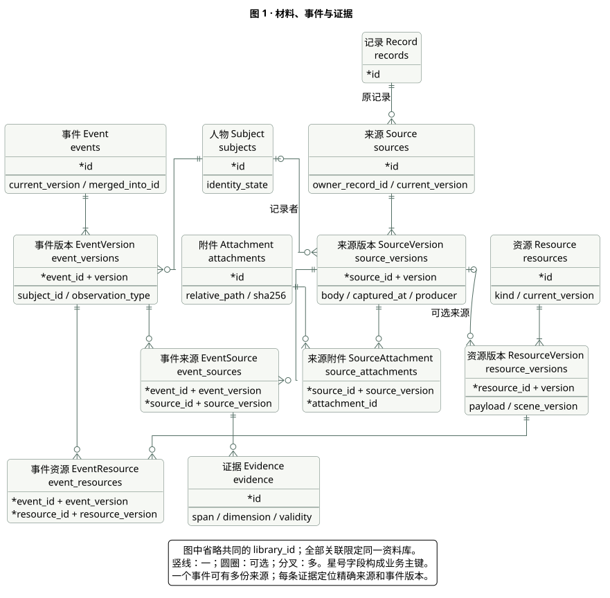
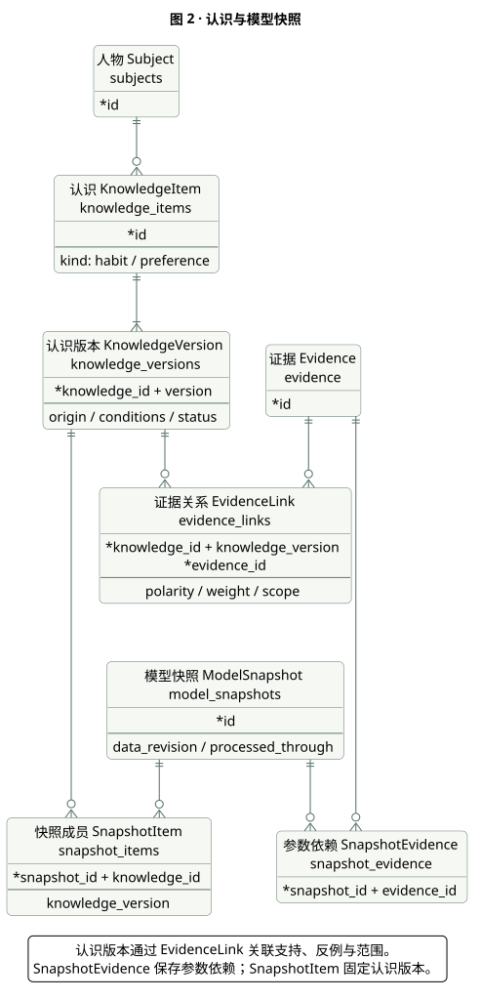
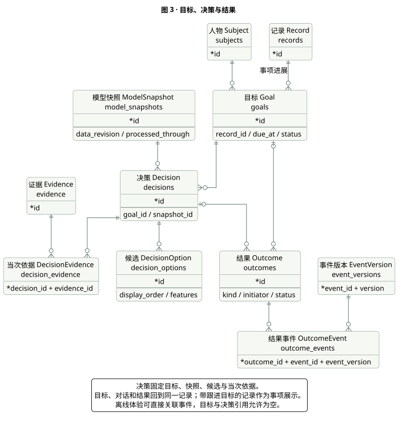
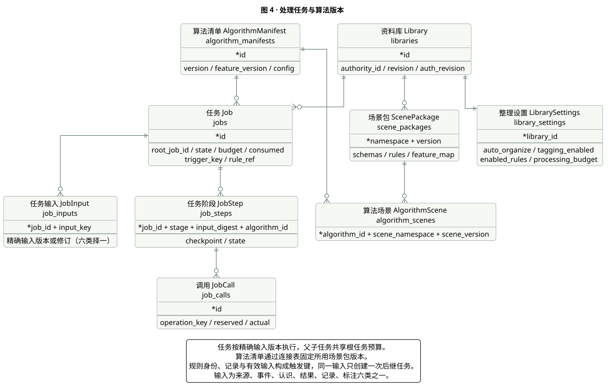
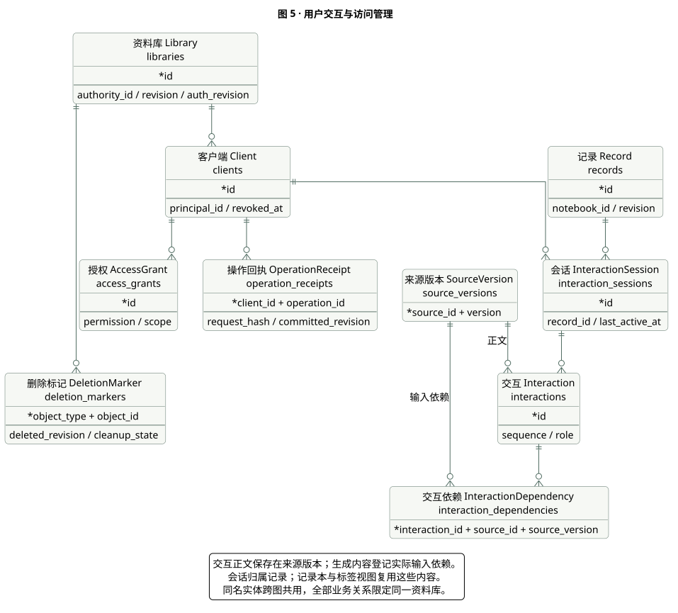
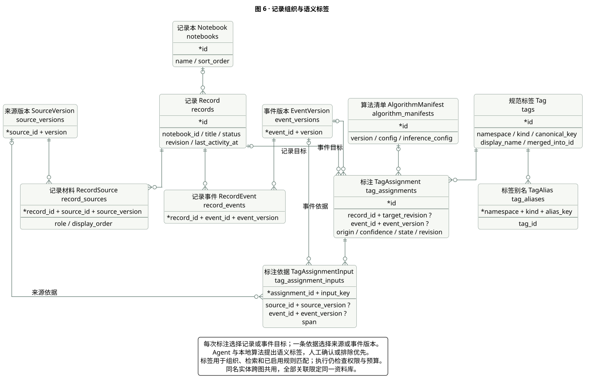

# 你所热爱的就是软件工程_数据库设计说明书

| 文档信息 | 内容 |
| --- | --- |
| 项目 | PebblePile · 叠石 |
| 版本与日期 | v1.1 · 2026-11-09 |
| 设计基线 | [产品需求文档 v1.3](prd.md)、[产品与技术调研 v1.3](research.md)、[信息架构 v1.1](information-architecture.md) |
| 配套设计 | [系统设计说明书](system-design.md) |
| 文档状态 | 概要设计；数据库、接口与验收方案随实现验证 |

## 1 引言

### 1.1 目的与范围

本设计把对话与记录、语义标签、事件证据、习惯偏好和事项结果组织成可追溯的本地事件数据库，供前端、核心、算法与测试成员共同实现。首页直接记录或对话；记录库以时间线、记录本和标签回查同一批内容；记忆与偏好在设置中管理，并从回答旁的依据入口就近纠正。

首期采用 SQLite 事务数据库、应用私有附件目录和可重建的全文索引。手机内的界面、系统入口和业务核心使用同一权威资料库。独立命令行使用相同数据格式；服务扩展在选定宿主运行自己的权威实例。该选型承接需求文档的候选方案，运行时版本、中文检索方案和容量预算在首轮验证中冻结。

文档参考 [GB/T 8567—2006《计算机软件文档编制规范》](https://openstd.samr.gov.cn/bzgk/gb/newGbInfo?hcno=84C42B6277D2714B7176B10C6E6B1A44) 第 7.14 节“数据库（顶层）设计说明”，按本地应用裁剪。第 1 节说明范围与引用，第 2 节记录数据库级决策，第 3—5 节展开概念、逻辑和物理结构，第 6 节说明访问操纵模块与运行规则，第 7 节给出需求追踪。

### 1.2 术语与记号

| 术语 | 含义 |
| --- | --- |
| PRD（Product Requirements Document） | 产品需求文档；本文的 F、N、A 编号均引用其中的功能、非功能要求和验收场景 |
| Agent | 使用上下文与工具完成任务的智能体 |
| 记录／事项 | `Record` 聚合正文来源、会话与事件；带跟进目标的记录作为事项呈现 |
| Agent 标签／语义标签 | Agent 结合本地算法为对话、记录与事件生成的分类和检索标记；保存来源、依据与修订 |
| 处理触发 | 保存、反馈、修订或约定时间引发的后台工作，与描述生活经历的 `Event` 分开保存 |
| ER（Entity–Relationship） | 实体关系；图中竖线表示一，圆圈表示可选，分叉表示多 |
| ORM（Object–Relational Mapping） | 对象关系映射，将领域对象映射到表与关联 |
| SQL（Structured Query Language） | 结构化查询语言 |
| PK／FK／UQ | 主键（Primary Key）／外键（Foreign Key）／唯一约束（Unique） |
| ID／UUID | 标识符（Identifier）／通用唯一标识符（Universally Unique Identifier） |
| JSON（JavaScript Object Notation） | 结构化载荷格式；Schema 指其字段与校验规则 |
| API（Application Programming Interface） | 应用程序接口 |
| CLI／URI | 命令行接口（Command-Line Interface）／统一资源标识符（Uniform Resource Identifier） |
| UTC（Coordinated Universal Time） | 协调世界时，数据库时间以其毫秒时间戳保存 |
| WAL（Write-Ahead Logging） | 预写日志，用于数据库提交与恢复 |
| FTS5（Full-Text Search 5） | SQLite 的全文检索模块 |
| OCR（Optical Character Recognition） | 光学字符识别；图片证据保存识别片段与原图区域 |
| SHA-256／MIME | 安全散列算法 256 位摘要／多用途互联网邮件扩展媒体类型 |
| MiB（Mebibyte） | 二进制容量单位，1 MiB = 1,048,576 字节 |
| 资料库修订／对象版本 | `library.revision` 表示业务提交顺序；对象版本表示同一对象的历史内容 |
| 处理水位 | `processed_through` 表示已完成或已显式终结的输入连续修订位置 |

数据表使用英文复数下划线名称，领域对象使用单数名称。后文的 `TEXT`、`INTEGER`、`REAL` 分别表示文本、整数和浮点数；`?` 表示可空，`J` 表示通过 Schema 校验的 JSON 文本，`T` 表示 UTC 毫秒整数。

### 1.3 引用文件

| 文件 | 本文采用的内容 |
| --- | --- |
| [产品需求文档](prd.md) v1.3 | F01—F14、记录与语义标签、一致性规则、接口与验收编号 |
| [产品与技术调研](research.md) v1.3 | 标签算法、证据依赖、条件模型、移动恢复与场景协议 |
| [信息架构](information-architecture.md) v1.1 | 对话与记录首页、记录库、设置及事项闭环 |
| [团队作业要求](../task-requirement.md) | 概要设计、ER 图、关系数据模型与对象关系映射 |
| [GB/T 8567—2006](https://openstd.samr.gov.cn/bzgk/gb/newGbInfo?hcno=84C42B6277D2714B7176B10C6E6B1A44) 第 7.14 节 | 数据库设计说明的分层结构、访问模块及需求追踪 |
| SQLite 官方文档 | 外键、WAL、全文检索与在线备份，链接随具体设计列出 |

## 2 外部设计

### 2.1 数据责任与访问方式

| 数据 | 写入方 | 读取方 | 保存原则 |
| --- | --- | --- | --- |
| 记录本、记录与内容关联 | 记录服务、用户编辑入口 | 首页、记录库、事项详情 | 内容保留稳定归属，各视图复用关联；移动记录本只改变组织关系 |
| 原始材料、附件、人物 | 摄取与修订服务 | 时间线、证据查看、抽取任务 | 先持久保存，再返回回执；修订保留版本 |
| 标签词表、标注与依据 | 标签服务、用户纠正入口 | 标签筛选、检索、规则匹配 | 归一与去重，固定输入和算法版本，人工决定优先 |
| 场景知识与算法清单 | 场景注册与配置服务 | 抽取、更新、工具校验 | 固定版本、来源、单位、校验摘要与复核记录 |
| 事件、证据、认识 | 业务核心与更新任务 | 记录详情、设置中的记忆与偏好、上下文服务 | 带人物、条件、版本及证据依赖 |
| 目标、候选、结果、交互 | 任务服务、用户反馈入口 | 当前对话、事项详情、评测 | 建议、选择、动作、回执和体验分别保存 |
| 任务、预算、操作回执 | 调度与事务服务 | 状态界面、恢复流程 | 阶段可恢复、提交可去重、预算可核对 |
| 授权、删除标记、审计 | 所有者操作与权限服务 | 每次读写、清理与诊断 | 最小范围授权；审计保存引用、状态与计量 |

应用通过仓储接口访问表，算法接收经过授权的输入和结构化工作结果。所有写入经业务核心完成版本校验、事务和权限检查。凭据由操作系统安全存储保管，数据库只保存凭据引用。

### 2.2 存储布局

```text
library-root/
  manifest.json          # 权威实例、资料库、数据格式与当前代次
  generations/<id>/
    library.sqlite       # 业务数据、任务与可重建索引
    attachments/<id>     # 已持久化附件，文件名由核心生成
  staging/               # 导入、恢复及待提交文件
```

一个资料库目录由一个业务核心协调写入。数据库与附件一起作为备份、恢复和迁移单位。附件采用独立随机标识命名，摘要用于完整性检查和重复提示；两次相同内容的真实经历仍可分别建事件。

### 2.3 规模与保留

功能与性能验收沿用 PRD N02：1,000 条事件、200 条偏好、100 条习惯、100 个目标、500 个资源版本。按正文、附件、版本、任务记录和索引分别统计空间，原始附件通常是主要增长项。单条文字上限 10,000 字符、单张图片上限 5 MiB、链接响应上限 2 MiB；导入前计算剩余空间及临时副本开销。

用户材料与有效版本按用户意图保留。阶段工作区在提交、取消或失效后清理；失败记录留下错误码、版本与计量。清理周期和容量上限属于部署配置，首次真机验证给出默认值。删除流程见第 6.4 节。

## 3 概念结构与 ER 图

### 3.1 材料、事件与证据

一份材料可以描述多个事件，一个事件也可以由多份材料共同支持。来源版本保存当时原话，事件版本保存当时解释；证据同时定位两者。领域资源独立存在，事件按需引用实际使用的资源版本。



[图 1 源文件](diagrams/database-evidence.puml)。`EventSource`、`EventResource` 和 `SourceAttachment` 是多对多关系的连接实体。

### 3.2 个人认识与使用反馈

`KnowledgeItem` 是习惯 `Habit` 与偏好 `Preference` 的共同持久化入口。`kind` 决定领域对象类型，每个版本保存相应统计或参数。证据关系指向精确认识版本，快照固定其成员及算法参数依赖，决策记录实际使用的快照。



[图 2 源文件](diagrams/database-model.puml)。图中的 `SnapshotEvidence` 保存快照级参数的证据依赖；认识本身的依赖保存在 `EvidenceLink`。即时建议建立一次性目标，空库建立空快照，因此决策也有明确的目标和模型版本。



[图 3 源文件](diagrams/database-feedback.puml)。决策固定候选及所用依据，实际结果通过连接实体关联精确事件版本。

### 3.3 任务、交互与治理

处理任务保存输入版本、阶段和预算。用户消息、Agent 回答、工具结果分别登记交互角色；长期保留的正文进入来源版本，交互表负责顺序与任务关系。场景包和算法清单提供可复现的知识与处理版本。



[图 4 源文件](diagrams/database-runtime.puml)。任务输入固定数据版本，算法清单固定场景包版本。



[图 5 源文件](diagrams/database-governance.puml)。会话归属记录，交互正文沿来源版本追溯。

### 3.4 记录与语义标签

`Notebook` 提供一层可选归类，`Record` 聚合来源版本、会话与事件。记录可以关联多个目标；需要持续跟进时，界面按事项展示这些目标的进展与结果。时间线、记录本和标签筛选读取同一组关系。

`Tag` 保存规范词，`TagAssignment` 保存一次标注及其状态。Agent 提出标签，本地规则完成分类约束、同义归一、去重、版本校验与提交。标签用于组织和检索；人物、发生时间、观察类型及偏好仍由相应领域实体表达。标签匹配只参与用户已启用规则的触发判断，执行时继续检查权限与预算。



[图 6 源文件](diagrams/database-record-tags.puml)。六张图按聚合展开，跨图同名实体指向同一张表；所有业务实体均属于一个 `Library`。图中展示主要外键，完整键与约束见第 4 节。

## 4 逻辑结构与关系模型

### 4.1 通用字段和约束

1. `libraries` 以 `id:TEXT` 为主键。其余业务表都带 `library_id:TEXT`，外键指向资料库；稳定实体主键为 `(library_id,id)`。
2. 版本表主键为 `(library_id,<entity>_id,version)`，版本从 1 递增。稳定实体的 `current_version` 指向本实体的版本；创建和切换指针在同一事务内完成，循环引用采用延迟外键。
3. 所有跨实体外键都包含 `library_id`。版本引用同时包含对象标识和版本号；可空复合引用的组成字段同时为空或同时有值。
4. 稳定实体带 `created_at:T`；可修改实体另带 `updated_at:T`、`revision:INTEGER`。版本表带 `created_at:T`、`created_revision:INTEGER`，正文按新版本追加；删除时按依赖清理历史正文。
5. 布尔值用 `INTEGER`，约束为 0 或 1；计数和预算非负；状态和类别用枚举检查；JSON 先做语法检查，再按指定场景或公共 Schema 校验。
6. 普通外键默认采用 `RESTRICT`。`current_version` 等循环指针采用 `NO ACTION DEFERRABLE INITIALLY DEFERRED`，由事务提交时统一检查；稳定行与其版本行可在同一事务中移除，独立删除标记继续保留。单纯连接行可随父项删除；业务对象先计算影响范围，再按依赖顺序清理。SQLite 的 `RESTRICT` 会立即检查，即使该外键声明为延迟检查也一样，相关语义见[外键删除动作](https://www.sqlite.org/foreignkeys.html#fk_actions)。

下列表格省略以上通用字段。稳定实体以 `id` 标识；版本表中的实体外键同时是其复合主键成员。连接表在“键与约束”列列出完整业务键，均隐含 `library_id`。

### 4.2 资料库、来源与资源

| 关系 | 主要字段及类型 | 键与约束 |
| --- | --- | --- |
| `libraries` | `authority_id:TEXT`、`owner_principal:TEXT`、`revision:INTEGER`、`schema_version:INTEGER`、`active_snapshot_id:TEXT?`、`auth_revision:INTEGER` | PK `id`；权威实例标识随迁移切换；活动快照引用同库快照 |
| `library_settings` | `auto_organize:INTEGER`、`tagging_enabled:INTEGER`、`enabled_rules:J`、`processing_budget:J` | PK/FK `library_id`；一库一份配置；规则项固定场景包版本、`rule_key`、适用记录范围与预算；修改使用 `revision` 并保留审计 |
| `subjects` | `display_name:TEXT`、`identity_state:TEXT` | PK `id`；归属状态 `confirmed/unresolved`；只有已确认人物可生成本人明确设置 |
| `sources` | `owner_record_id:TEXT`、`kind:TEXT`、`current_version:INTEGER`、`recorder_client_id:TEXT`、`capture_key:TEXT?`、`status:TEXT` | PK `id`；FK 原记录、记录客户端；UQ `(recorder_client_id,capture_key)`，空值允许；状态 `saved/deleted` |
| `source_versions` | `source_id:TEXT`、`version:INTEGER`、`recorder_subject_id:TEXT?`、`body:TEXT?`、`origin_uri:TEXT?`、`source_app:TEXT?`、`captured_at:T`、`purpose:TEXT`、`producer:TEXT`、`content_hash:TEXT` | PK `(source_id,version)`；FK 可选记录者人物；至少有正文、链接快照或附件；`producer=user/agent/tool/import`；摘要作为重复提示 |
| `attachments` | `relative_path:TEXT`、`sha256:TEXT`、`media_type:TEXT`、`byte_size:INTEGER`、`width:INTEGER?`、`height:INTEGER?`、`state:TEXT` | PK `id`；UQ `relative_path`；路径限私有根目录；状态 `ready/pending_delete` |
| `source_attachments` | `source_id:TEXT`、`source_version:INTEGER`、`attachment_id:TEXT`、`role:TEXT` | PK `(source_id,source_version,attachment_id)`；FK 精确来源版本、附件 |
| `resources` | `kind:TEXT`、`current_version:INTEGER` | PK `id`；资源类别由场景包定义 |
| `resource_versions` | `resource_id:TEXT`、`version:INTEGER`、`parent_version:INTEGER?`、`source_id:TEXT?`、`source_version:INTEGER?`、`scene_namespace:TEXT`、`scene_version:TEXT`、`schema_name:TEXT`、`payload:J`、`collected_at:T`、`valid_until:T?` | PK `(resource_id,version)`；FK 父版本、可选来源版本、场景包；过期报价保留历史，查询标记失效 |

来源修订保存用户当时提供的原文。`recorder_subject_id` 表示记录者，事件的 `subject_id` 表示经历者，`recorder_client_id` 表示提交入口。OCR 结果和抽取结果属于后续处理产物；原图区域以附件标识和归一化坐标定位。用户编辑菜谱或行程时产生资源新版本，既有事件继续指向原版本。

### 4.3 记录、标签、事件与证据

#### 4.3.1 记录组织

| 关系 | 主要字段及类型 | 键与约束 |
| --- | --- | --- |
| `notebooks` | `name:TEXT`、`sort_order:INTEGER` | PK `id`；浅层集合，记录本名允许用户调整 |
| `records` | `notebook_id:TEXT?`、`title:TEXT`、`title_origin:TEXT`、`status:TEXT`、`last_activity_at:T` | PK `id`；FK 可选记录本；状态 `active/archived/deleted`；标题起源 `manual/agent/source` |
| `record_sources` | `record_id:TEXT`、`source_id:TEXT`、`source_version:INTEGER`、`role:TEXT`、`display_order:INTEGER` | PK `(record_id,source_id,source_version)`；FK 记录、精确来源版本；角色 `body/attachment/message/reference`；一条来源可在其他记录中引用 |
| `record_events` | `record_id:TEXT`、`event_id:TEXT`、`event_version:INTEGER` | PK 三项；FK 记录、精确事件版本 |

正文与附件只在来源体系保存，`sources.owner_record_id` 固定原记录，记录页通过关联读取。用户在原记录续写、编辑或对话时追加来源版本与关联，并更新记录修订；界面按来源的当前版本显示正文，历史版本在修订详情中查看。跨记录引用使用 `reference` 角色，保留原来源身份与所引版本；其他角色归属原记录。重复引用按来源、事件标识去重。一个记录可描述多个事件，一个事件可关联多份记录，实际经历仍按事件计数。

记录首次保存时落库，空白编辑器只保留草稿。删除记录本可将记录移入未归类集合；删除记录则先按第 6.4 节预览内容与派生影响。移动记录本、归档及视图筛选保留原始材料和事件关系。

#### 4.3.2 语义标签

| 关系 | 主要字段及类型 | 键与约束 |
| --- | --- | --- |
| `tags` | `namespace:TEXT`、`kind:TEXT`、`canonical_key:TEXT`、`display_name:TEXT`、`merged_into_id:TEXT?`、`status:TEXT` | PK `id`；UQ `(namespace,kind,canonical_key)`；FK 同库合并目标，检查无环；状态 `active/merged/retired` |
| `tag_aliases` | `namespace:TEXT`、`kind:TEXT`、`alias_key:TEXT`、`tag_id:TEXT` | PK `(namespace,kind,alias_key)`；FK 标签；同一命名空间和类别中的别名只指向一个规范词 |
| `tag_assignments` | `tag_id:TEXT`、`record_id:TEXT?`、`target_revision:INTEGER?`、`event_id:TEXT?`、`event_version:INTEGER?`、`origin:TEXT`、`algorithm_id:TEXT?`、`confidence:REAL?`、`state:TEXT`、`supersedes_id:TEXT?` | PK `id`；FK 标签、可选记录或精确事件版本、算法、被替代标注；记录和事件目标二选一；记录目标须保存当次 `target_revision` |
| `tag_assignment_inputs` | `assignment_id:TEXT`、`input_key:TEXT`、`source_id:TEXT?`、`source_version:INTEGER?`、`event_id:TEXT?`、`event_version:INTEGER?`、`span:J?` | PK `(assignment_id,input_key)`；FK 标注；来源版本与事件版本二选一，各自使用复合 FK；来源位置沿用证据的码点或图像区域规则 |

`kind` 首期采用 `scene/topic/action/context/person/time`，类别由公共 Schema 和场景包约束。人物与时间标签用于展示和检索，其权威值分别来自 `Subject` 和 `EventVersion`；标签名称变化不修改人物归属或发生时间。词表的规范化方法、同义映射和阈值写入算法清单；跨类别的同名词分别保存。

`origin` 为 `manual/agent/rule`，`state` 为 `pending/active/rejected/retracted`。自动标注记录算法与模型配置、完整输入依赖和可用的置信度；非空 `confidence` 限 `[0,1]`，其含义与阈值固定在算法清单中，人工标注的置信度可为空。来源不足、分类冲突或低于阈值的候选进入 `pending`，查询默认只使用有效的 `active` 标注。确认候选时撤回原候选，形成新的人工有效标注并关联被替代项，保留原算法来源。`rejected` 限人工排除，以稳定目标标识和归一标签保存决定，后续重算继续遵守，直到用户撤销；同一目标、规范标签的人工有效项与排除项互斥。

同一目标、规范标签至多有一个有效标注，记录目标和事件目标分别设置部分唯一索引。用户修改通过 `revision` 比较；系统迟到结果须同时核对目标修订、输入版本及人工决定。旧输入改变后自动标注转为 `retracted`，新候选在有效版本上重新生成。人工标注仍显示其人工来源；直接附着于旧事件版本的标注在事件修订时，按同一事务迁移或要求核对，原标注留作修订记录。合并标签时解析最终规范词，合并重复有效项并保留原标注依赖。标签发布只改变标注和处理状态；记录的 `last_activity_at` 由用户内容或实际事项进展更新，普通后台整理保持时间线位置。

#### 4.3.3 事件与证据

| 关系 | 主要字段及类型 | 键与约束 |
| --- | --- | --- |
| `events` | `current_version:INTEGER`、`merged_into_id:TEXT?`、`status:TEXT` | PK `id`；FK 同库目标事件；合并目标指向最终代表事件并检查无环；状态 `active/merged/retracted` |
| `event_versions` | `event_id:TEXT`、`version:INTEGER`、`subject_id:TEXT`、`action:TEXT`、`object_text:TEXT?`、`occurred_from:T?`、`occurred_to:T?`、`time_precision:TEXT`、`timezone:TEXT?`、`observation_type:TEXT`、`context:J`、`scene_namespace:TEXT?`、`scene_version:TEXT?` | PK `(event_id,version)`；FK 人物、可选场景包；时间精度 `exact/day/interval/unknown`；区间起点≤终点 |
| `event_sources` | `event_id:TEXT`、`event_version:INTEGER`、`source_id:TEXT`、`source_version:INTEGER` | PK 四项；FK 精确事件、来源版本；保留多份材料支持同一事件的关系 |
| `event_resources` | `event_id:TEXT`、`event_version:INTEGER`、`resource_id:TEXT`、`resource_version:INTEGER`、`role:TEXT` | PK 前四项；FK 精确事件、资源版本 |
| `evidence` | `event_id:TEXT`、`event_version:INTEGER`、`source_id:TEXT`、`source_version:INTEGER`、`span:J`、`dimension:TEXT`、`value:J`、`validity:TEXT` | PK `id`；四项复合 FK 指向 `event_sources`；有效性 `valid/disputed/invalid`；位置校验在来源版本范围内 |

`observation_type` 取 `actual/planned/hypothetical/reported/bookmarked/agent_generated`。文本位置保存半开区间 `[start,end)`，偏移按 Unicode 码点计数；图片位置保存附件标识与 `[0,1]` 范围的矩形。原话由来源读取，证据表保存引用和结构化值。

独立证据按合并后的实际事件计数，人数、来源数和消息数都不替代事件数。合并事件保留旧标识映射，重建认识证据关系和受影响快照；记录视图解析到最终事件，相关自动标签重新校验，人工确认／排除按最终事件和规范标签合并并保留原修订关系。

### 4.4 认识、算法与模型快照

| 关系 | 主要字段及类型 | 键与约束 |
| --- | --- | --- |
| `knowledge_items` | `subject_id:TEXT`、`kind:TEXT`、`current_version:INTEGER`、`use_enabled:INTEGER` | PK `id`；FK 人物；`kind=habit/preference` |
| `knowledge_versions` | `knowledge_id:TEXT`、`version:INTEGER`、`origin:TEXT`、`statement:TEXT`、`conditions:J`、`statistics:J?`、`parameters:J?`、`status:TEXT`、`algorithm_id:TEXT?`、`valid_from:T?`、`valid_until:T?` | PK `(knowledge_id,version)`；FK 算法清单；起源 `explicit/inferred`；状态见下文 |
| `evidence_links` | `knowledge_id:TEXT`、`knowledge_version:INTEGER`、`evidence_id:TEXT`、`polarity:TEXT`、`weight:REAL`、`scope:J` | PK 前三项；FK 认识版本、证据；`support/oppose`；权重≥0；范围限定人物、场景与条件 |
| `algorithm_manifests` | `version:TEXT`、`method:TEXT`、`feature_version:TEXT`、`config:J`、`code_hash:TEXT`、`inference_config:J` | PK `id`；固定更新方法、特征、阈值、模型提供方与模型/分词器版本；配置保存凭据引用 |
| `algorithm_scenes` | `algorithm_id:TEXT`、`scene_namespace:TEXT`、`scene_version:TEXT` | PK 三项；FK 算法清单、场景包；明确该算法清单使用的场景版本集合 |
| `model_snapshots` | `data_revision:INTEGER`、`processed_through:INTEGER`、`algorithm_id:TEXT`、`parameters:J`、`status:TEXT`、`pending_rebuild:INTEGER` | PK `id`；FK 算法清单；状态 `candidate/active/superseded/invalidated`；UQ 同库的活动快照 |
| `snapshot_items` | `snapshot_id:TEXT`、`knowledge_id:TEXT`、`knowledge_version:INTEGER` | PK `(snapshot_id,knowledge_id)`；FK 快照、认识版本 |
| `snapshot_evidence` | `snapshot_id:TEXT`、`evidence_id:TEXT`、`dependency_role:TEXT` | PK 前两项；FK 快照、证据；覆盖共享参数、领域参数及情境参数的全部训练依赖 |

认识状态为 `pending/active/conflict/superseded/retracted`，分别对应待核对、有效、冲突、已取代、已撤回。`use_enabled` 单独控制查询参与。`statistics` 对习惯保存观察窗口、观察次数、命中次数、时间分布、覆盖说明及例外；`parameters` 对偏好保存维度、单位、尺度、共享项、领域项和情境项。两类载荷按 `kind` 校验。

一次本人明确表达可形成明确设置；推断偏好至少有两次独立实际经历，习惯至少有三次观察。阈值写入算法清单，后续调整产生新清单。推断参与排序还需满足有效状态、辅助开关和适用条件。

快照通过算法清单及 `algorithm_scenes` 固定所用场景包版本。参数依赖既包括当前证据，也包括继承参数的历史依赖闭包。由旧快照增量更新时，继承其 `snapshot_evidence` 后再加入本次证据；纠正可据此定位所有受影响参数。

### 4.5 目标、决策、结果与交互

| 关系 | 主要字段及类型 | 键与约束 |
| --- | --- | --- |
| `goals` | `record_id:TEXT`、`subject_id:TEXT`、`requirements:J`、`due_at:T?`、`status:TEXT`、`executor_kind:TEXT`、`executor_ref:TEXT?`、`check_interval_ms:INTEGER?`、`last_checked_at:T?`、`next_check_at:T?`、`data_valid_until:T?` | PK `id`；FK 记录、人物；一条记录可有多个目标；状态 `active/waiting/completed/cancelled/expired` |
| `decisions` | `goal_id:TEXT`、`snapshot_id:TEXT`、`used_library_revision:INTEGER`、`context:J`、`chosen_option_id:TEXT?`、`status:TEXT` | PK `id`；FK 目标、快照；选择项用 `(id,chosen_option_id)` 指向本决策候选；状态 `proposed/chosen/superseded/redacted` |
| `decision_options` | `decision_id:TEXT`、`display_order:INTEGER`、`resource_id:TEXT?`、`resource_version:INTEGER?`、`features:J`、`payload:J`、`available_at:T`、`valid_until:T?` | PK `id`；UQ `(decision_id,id)`、`(decision_id,display_order)`；FK 决策、可选资源版本 |
| `decision_evidence` | `decision_id:TEXT`、`evidence_id:TEXT`、`role:TEXT` | PK 前两项；FK 决策、证据；记录上下文使用的事实、支持与反例，补足快照之外的当次依据 |
| `outcomes` | `goal_id:TEXT?`、`decision_id:TEXT?`、`kind:TEXT`、`initiator:TEXT`、`observation_method:TEXT`、`observed_at:T`、`status:TEXT`、`payload:J`、`action_key:TEXT?` | PK `id`；FK 可选目标、决策；二者同时存在时目标一致；`action_key` 关联执行适配器幂等标识 |
| `outcome_events` | `outcome_id:TEXT`、`event_id:TEXT`、`event_version:INTEGER` | PK 三项；FK 结果、精确事件版本 |
| `interaction_sessions` | `record_id:TEXT`、`client_id:TEXT`、`last_active_at:T` | PK `id`；FK 记录、客户端；会话在首次消息保存时与记录关联 |
| `interactions` | `session_id:TEXT`、`sequence:INTEGER`、`role:TEXT`、`source_id:TEXT`、`source_version:INTEGER`、`snapshot_id:TEXT?`、`decision_id:TEXT?` | PK `id`；UQ `(session_id,sequence)`；FK 会话、正文来源版本、可选快照和决策；角色 `user/assistant/tool` |
| `interaction_dependencies` | `interaction_id:TEXT`、`source_id:TEXT`、`source_version:INTEGER` | PK 三项；FK 交互、精确输入来源版本；记录生成交互实际使用的材料 |

`outcomes.kind` 取 `user_choice/action_request/receipt/observation/user_feedback`；动作状态为 `requested/verifying/succeeded/failed/unknown`，体验以对应结果类型记录。选择项、页面变化或请求成功各有自己的结果记录。离线反馈可先关联事件，目标与决策允许为空。

交互正文只保存一份，位于 `source_versions`，并登记到会话所属记录的 `record_sources`。一条记录可有多个会话，继续事项时复用记录和目标；即时建议也归入当前记录。Agent 或工具产物的 `producer` 随来源保存，进入抽取流程时沿用生成内容类别。生成交互同时登记来源依赖及所用快照，删除时能够清理受影响回答。语义标签可以定位这些来源片段，记录库仍按记录或实际进展聚合展示。

### 4.6 任务与幂等

| 关系 | 主要字段及类型 | 键与约束 |
| --- | --- | --- |
| `jobs` | `parent_job_id:TEXT?`、`root_job_id:TEXT`、`kind:TEXT`、`state:TEXT`、`wait_reason:TEXT?`、`priority:INTEGER`、`algorithm_id:TEXT`、`base_revision:INTEGER`、`auth_revision:INTEGER`、`trigger_key:TEXT?`、`rule_ref:J?`、`budget:J`、`consumed:J`、`lease_token:INTEGER`、`lease_until:T?`、`cancel_requested:INTEGER`、`error_code:TEXT?` | PK `id`；FK 父任务、根任务、算法；UQ `trigger_key`；根任务引用自身并保存共享预算；`base_revision` 为跨对象处理的资料库基准修订；领取时递增租约令牌 |
| `job_inputs` | `job_id:TEXT`、`input_key:TEXT`、`source_id/source_version?`、`event_id/event_version?`、`knowledge_id/knowledge_version?`、`outcome_id:TEXT?`、`record_id/record_revision?`、`assignment_id/assignment_revision?` | PK `(job_id,input_key)`；六类输入恰选一种；版本实体使用精确复合 FK，记录和标注使用稳定标识 FK 并保存修订作为运行时校验值 |
| `job_steps` | `job_id:TEXT`、`stage:TEXT`、`input_digest:TEXT`、`algorithm_id:TEXT`、`state:TEXT`、`checkpoint:J`、`attempts:INTEGER` | PK `(job_id,stage,input_digest,algorithm_id)`；FK 任务、算法；同一输入和阶段只发布一次 |
| `job_calls` | `job_id:TEXT`、`stage:TEXT`、`input_digest:TEXT`、`algorithm_id:TEXT`、`kind:TEXT`、`operation_key:TEXT`、`provider_request_id:TEXT?`、`state:TEXT`、`reserved:J`、`actual:J?`、`started_at:T`、`finished_at:T?` | PK `id`；前四项复合 FK 指向任务阶段；UQ `operation_key`；类型 `model/tool/ocr` |
| `operation_receipts` | `client_id:TEXT`、`operation_id:TEXT`、`request_hash:TEXT`、`result_refs:J`、`committed_revision:INTEGER` | PK `(client_id,operation_id)`；FK 客户端；同键异载荷返回冲突；回执只保存标识与状态 |

任务状态统一为 `queued/running/waiting/needs_review/completed/failed/cancelled/stale`。主动暂停保存为 `waiting`，`wait_reason=user_paused`；等待网络、模型或预算分别记录原因。`job_inputs` 中各标识为 `TEXT`，各版本号为 `INTEGER`。阶段状态取 `pending/running/completed/failed/waiting`，调用状态取 `reserved/sent/succeeded/failed/unknown/cancelled`。检查点只记录已持久提交的阶段产物引用、输入版本和剩余工作。工作区内容携带来源依赖，删除时随输入清理。

保存、反馈、纠正和标签发布在业务事务内按设置创建后继任务。`rule_ref` 固定场景包命名空间、版本及 `rule_key`；`trigger_key` 由规则身份、目标记录、业务触发种类及有效输入修订的摘要构成。重复投递返回已有任务；标签发布复用同一因果链和根预算，规则限制可响应的触发种类，避免生成内容反复触发自身。到期处理额外固定目标的约定时间槽，实际在前台、平台允许的后台机会或已配置宿主运行。任务状态只更新原记录的进度与待回应提示。

预算限额沿用 F09：一次文本整理或查询共 3 次模型调用，每次输入最多 4,096 个 token、输出最多 1,024 个 token，8 次业务工具调用、120 秒累计活动时间。token 是模型分词器的计量单位。分段、子任务和重试通过 `root_job_id` 共用预算；OCR、系统等待和用户等待分别记账。

### 4.7 场景、授权与运维

| 关系 | 主要字段及类型 | 键与约束 |
| --- | --- | --- |
| `scene_packages` | `namespace:TEXT`、`version:TEXT`、`schemas:J`、`feature_map:J`、`rules:J`、`prompts:J`、`examples:J`、`tool_contracts:J`、`source_refs:J`、`license:TEXT`、`reviewed_by:TEXT`、`checksum:TEXT`、`enabled:INTEGER` | PK `(namespace,version)`；版本内容固定；规则含标签类别、归一映射和可选处理触发，每条触发有稳定 `rule_key`；用户启用范围由 `library_settings` 保存 |
| `clients` | `principal_id:TEXT`、`kind:TEXT`、`credential_ref:TEXT?`、`revoked_at:T?` | PK `id`；`kind=app/system_action/cli/service`；认证身份来自宿主或连接认证 |
| `access_grants` | `client_id:TEXT`、`permission:TEXT`、`scope:J`、`expires_at:T?`、`revoked_at:T?` | PK `id`；FK 客户端；权限 `read/record/propose/explicit_setting/revise/delete/export`；范围含人物、来源与场景过滤 |
| `deletion_markers` | `object_type:TEXT`、`object_id:TEXT`、`deleted_revision:INTEGER`、`deleted_at:T`、`cleanup_state:TEXT` | PK `(object_type,object_id)`；保留无正文标识；状态 `pending/complete` |
| `audit_events` | `client_id:TEXT?`、`operation:TEXT`、`object_refs:J`、`revision:INTEGER`、`status:TEXT`、`metrics:J`、`occurred_at:T` | PK `id`；审计保存引用与计量，删除后引用可指向删除标记 |

来源、证据和人物范围由权限服务解读，查询与写入都执行范围检查。`library_id` 负责隔离数据，`principal_id` 和有效授权决定操作权。撤权事务递增 `auth_revision`，运行中的任务在提交前重查该值。

记录本和标签只表达组织关系。检索先限定获准来源，再计算标签计数、事件候选和结果；对来源范围受限的外部客户端，完整记录聚合要求其全部成员来源可读，否则只通过来源级接口返回获准内容。自动标题、标签与摘要按其输入依赖过滤，避免通过分类、数量或预览泄露范围外材料。

### 4.8 规范化与冗余

稳定身份、内容版本和多对多关系分表，公共关联字段进入显式列。资源载荷、情境、场景规则和算法参数使用版本化 JSON，避免为每个生活领域新增一套表。

`current_version`、`active_snapshot_id`、任务消耗计数和全文索引是有意保留的派生状态，分别由版本事务、发布事务、预算事务和索引更新维护。快照以引用固定成员，参数单独保存；正文通过来源版本回查。JSON 中需要独立权限过滤、连接或排序的字段，在查询需求稳定后提升为列和索引。

## 5 物理结构与对象关系映射

### 5.1 数据库配置与索引

每个连接启用 `PRAGMA foreign_keys=ON`，事务内使用同资料库的复合外键。SQLite 的外键启用和父键唯一性要求见[官方外键文档](https://www.sqlite.org/foreignkeys.html)。

采用 WAL、`synchronous=FULL` 和受限写入队列，模型推理放在写事务外。读事务尽快结束，维护窗口处理检查点和空间回收；实际可用性结合手机文件系统与运行时验证。WAL 支持读写并行，但仍需控制写入竞争及日志增长，依据见[官方 WAL 文档](https://www.sqlite.org/wal.html)。

| 索引 | 目的 |
| --- | --- |
| 所有 FK 的子表列前缀 | 降低关联检查、依赖传播和删除成本 |
| `records(library_id,notebook_id,status,last_activity_at)` | 记录本与近期内容分页；时间线同时读取来源采集时间和事件发生时间 |
| `record_sources(library_id,source_id,source_version)`、`record_events(library_id,event_id,event_version)` | 按同一内容定位记录视图与受影响聚合 |
| `tags(library_id,namespace,kind,canonical_key)`、`tag_aliases` 的主键 | 规范词和同义词查找与去重 |
| `tag_assignments(library_id,tag_id,state,record_id)`、`tag_assignments(library_id,tag_id,state,event_id,event_version)` | 标签筛选后回查目标和有效版本；分别以 `state='active'` 对目标＋标签建唯一索引 |
| `tag_assignment_inputs` 的来源和事件版本引用 | 修订、删除、撤权时定位失效标注 |
| `interaction_sessions(library_id,record_id,last_active_at)`、`goals(library_id,record_id,status)` | 在原记录中继续对话并聚合事项进展 |
| `event_versions(library_id,subject_id,occurred_from)` | 人物与时间线查询，连接当前版本过滤 |
| `source_versions(library_id,content_hash)` | 重复材料提示 |
| `knowledge_items(library_id,subject_id,kind,use_enabled)` | 读取当前人物的有效认识 |
| `evidence_links(library_id,evidence_id)`、`snapshot_evidence(library_id,evidence_id)` | 由纠正证据定位认识与快照 |
| `snapshot_items(library_id,knowledge_id,knowledge_version)` | 由认识版本定位历史使用范围 |
| `decision_evidence(library_id,evidence_id)` | 定位使用该证据的决策上下文 |
| `goals(library_id,status,next_check_at)` | 读取待处理目标及最近检查状态 |
| `jobs(library_id,state,priority,lease_until)` | 调度、恢复和租约回收 |
| `job_inputs` 的各类输入引用 | 来源变化后取消或重建依赖任务 |
| `interactions(library_id,snapshot_id)`、`interaction_dependencies(library_id,source_id,source_version)` | 清理受影响的生成交互 |

全文索引保存来源标识、版本、正文和必要筛选字段。查询取得候选后，回表核对当前有效性和权限，再读取正文。索引按业务事务同步更新；重建时使用有效来源重新生成。中文分词与短词召回用冻结语料比较后确定；所选运行时需具备对应 FTS5 能力。[FTS5 官方文档](https://www.sqlite.org/fts5.html)

标签检索按规范词表先归一查询词，再与授权范围内的有效标注、时间和全文条件求交。相同来源或事件命中多个标签时按稳定标识去重，记录页通过关联聚合，模型整理尚未完成的内容仍可按原文检索。标签与全文索引都可重建；人工确认和排除决定属于业务数据，随备份保留。

### 5.2 ORM 映射

| 领域对象 | 表与映射方式 | 加载与写入边界 |
| --- | --- | --- |
| `Library`、`Subject` | `libraries`、`subjects` | 资料库连接先绑定认证上下文；人物按同库查询 |
| `Notebook`、`Record` | `notebooks`、`records`、`record_sources`、`record_events` | 记录聚合协调内容关联与修订，正文按来源版本加载；事项通过目标关联呈现 |
| `Tag`、`TagAssignment` | `tags`、`tag_aliases`、`tag_assignments`、`tag_assignment_inputs` | 规范词归一、标注状态与输入依赖一并提交，人工决定参与后续发布校验 |
| `Source`、`SourceVersion`、`Attachment` | `sources`、`source_versions`、`attachments`、`source_attachments` | 来源聚合负责版本和附件关联，附件正文按需读取 |
| `Resource`、`ResourceVersion` | `resources`、`resource_versions` | 资源修改追加版本，父版本限同一资源 |
| `Event`、`EventVersion` | `events`、`event_versions`、`event_sources`、`event_resources` | 一个事件版本连同来源映射原子写入 |
| `Evidence` | `evidence` | 值对象 `SourceSpan` 映射 `span`，创建时校验来源位置与人物范围 |
| `KnowledgeItem` → `Habit`／`Preference` | `knowledge_items`、`knowledge_versions` | 依据 `kind` 构造具体类型；`HabitStats`、`PreferenceParameters` 映射各自 JSON 载荷 |
| `EvidenceLink` | `evidence_links` | 认识版本和证据的显式连接实体，保留正反关系、权重与适用范围 |
| `ModelSnapshot` | `model_snapshots`、`snapshot_items`、`snapshot_evidence` | 快照聚合一次发布，读取返回固定版本集合 |
| `Goal`、`Decision`、`DecisionOption` | `goals`、`decisions`、`decision_options`、`decision_evidence` | 候选、顺序、特征、依据和快照一并保存；选择以修订号更新 |
| `Outcome` | `outcomes`、`outcome_events` | 独立结果实体；不同结果类别分别写入 |
| `InteractionSession`、`Interaction` | 会话、交互及来源依赖三表 | 正文回链 `SourceVersion`，分页加载会话 |
| `Job`、`JobStep`、`JobCall` | 任务、输入、阶段、调用四表 | 调度器通过短事务取得租约和预留预算，阶段结果按幂等键提交 |
| `ScenePackage`、`AlgorithmManifest` | 场景包、算法清单及 `algorithm_scenes` | 版本化值对象及固定场景引用；加载后只读，启用配置单独修改 |
| `Client`、`AccessGrant` | 客户端与授权表 | 权限服务集中校验，安全存储读取实际凭据 |

仓储接口按聚合划分：`RecordRepository`、`TagRepository`、`SourceRepository`、`EventRepository`、`KnowledgeRepository`、`SnapshotRepository`、`TaskRepository` 和 `AccessRepository`。事务由业务用例统一协调，避免嵌套写入各自提交。领域层保留习惯与偏好的语义，数据库共用其版本和证据关系。

## 6 访问操纵模块与运用设计

| 模块 | 访问关系 | 主要职责 |
| --- | --- | --- |
| 记录服务 `RecordService` | 记录本、记录、来源关联、事件关联、会话、目标 | 保持同一内容归属，提供时间线、记录本和事项聚合 |
| 标签服务 `TaggingService` | 词表、别名、标注、输入依赖、算法清单 | 抽取、归一、校验与人工纠正，返回检索和规则匹配所需的有效标签 |
| 摄取与修订服务 | 来源、附件、事件、操作回执 | 持久保存、版本追加、幂等与事件合并 |
| 证据与模型服务 | 证据、认识、算法、快照 | 校验、统计、参数更新、依赖维护与原子发布 |
| 上下文与任务服务 | 目标、决策、结果、交互 | 预算内组装、记录实际使用与结果回流 |
| 调度服务 | 任务、输入、阶段、调用 | 租约、检查点、预算预留、恢复和取消 |
| 权限与生命周期服务 | 授权、删除标记、审计及各业务关系 | 范围检查、撤权、依赖清理、备份恢复与格式迁移 |

### 6.1 保存材料与附件一致性

1. 验证大小、媒体类型、读取权限和目标路径，将附件复制到暂存区，计算摘要并刷盘。
2. 将文件移入本库的稳定附件位置。此时尚未返回保存回执；中断留下的孤立文件由启动扫描回收。
3. 开启短写事务，检查权限和操作键，创建或更新记录，写入来源、来源版本、附件与关联；对话同时写入会话和交互。按用户的自动整理设置写入首个任务及操作回执，递增资料库修订。
4. 提交成功后返回“已保存”、记录与来源版本、可选任务标识和提交修订。仅记录无需等待模型；事务失败保留输入和错误原因，稳定目录中的孤立文件进入回收队列。

附件目录与数据库采用“文件先就绪、引用后提交”的顺序，使已确认来源总能读取持久副本。文件删除采用相反的标记、解除引用、异步清理顺序，进程重启后继续执行。

### 6.2 更新、并发与发布

单对象修改请求的 `baseRevision` 对应目标稳定实体的 `revision`。核心在事务中比较该修订，匹配后追加版本、切换当前指针并递增 `library.revision`；冲突返回当前版本和用户输入。跨对象批量修改使用资料库修订，并逐项校验精确输入版本。

同一客户端的 `operation_id` 只对应一份请求摘要。重试先查 `operation_receipts`，相同请求返回原回执；同键不同内容报告冲突。记录去重与事件去重分别处理，重复上传材料沿用来源关系，新经历获得独立事件。

标签整理按“读取获准输入 → Agent／规则提出候选 → 类别与同义归一 → 校验依据、人工决定和目标修订 → 原子发布”执行。发布事务同时写入词表引用、标注、完整依赖和阶段检查点，再为已启用且匹配的规则创建幂等后继任务。低置信度和冲突候选保留为待核对，自动结果不能覆盖人工确认或排除。用户改标签只更改标注；修改原话、人物或时间时，才按相应领域修订传播影响。

模型更新读取修订为 `r` 的输入，事务外完成抽取和计算。发布事务重查输入版本、证据有效性、删除标记、授权修订、任务租约、取消及预算，随后插入快照、成员和依赖，替换活动指针。候选快照在提交前保持不可见。`data_revision=r` 记录计算依据，发布本身产生更晚的资料库修订。

`processed_through` 从上一连续水位向前推进，遇到仍在等待或核对的输入就停止。后续输入即使先完成，也分别记录阶段结果，避免用最大完成修订掩盖缺口。查询在一个读事务内取得活动快照、资料库修订和水位。

### 6.3 中断、远程调用与预算

调度器领取任务时原子递增 `lease_token` 并设置 `lease_until`；提交同时比较令牌和有效期限，旧执行者即使迟到也无法使用新租约。进程退出后由恢复流程核对过期租约与阶段检查点。提交键包含输入摘要、阶段和算法版本，重复执行复用已提交结果。成功、失败及待核对检查点均在事务中复核租约、取消、输入版本、权限和删除标记；规则任务在执行及发布前还重读规则启用状态、范围与预算。停用或改变规则使不再匹配的任务退出提交，已发送动作按结果回执核对；失效任务只更新相应终态和无正文诊断。

每次调用前，在同一事务内锁定根任务预算并写入 `job_calls` 预留。收到结果后核对操作标识，再登记实际计量；网络超时保留预留与 `unknown` 状态，先查询提供方结果或让用户核对。预留释放依据明确的未执行或结算证据，防止重试超支。预算耗尽进入 `waiting`，原因记为 `budget_exhausted`；追加额度经用户确认后保存新的授权与审计记录，重试沿用已有消耗。活动时间只累计实际运行区间，等待时间单列。

### 6.4 纠正、停用与删除

**纠正。** 在同一事务内追加正确版本，将旧证据或认识标为失效，停用受影响快照，创建重算任务，并发布只含仍有效认识和明确设置的轻量快照，标记 `pending_rebuild=1` 并保留处理水位。轻量快照将快照级共享、领域和情境参数置空，同时清空相应参数依赖；过渡期使用有效明确设置与条件规则。查询展示整理进度，重算完成后发布完整参数与快照。

**停用。** 修改 `use_enabled` 并更新活动快照；来源和证据保留，重新启用时校验当前条件与依赖。

**标签纠正。** 确认、改名、合并或拒绝标签都保留操作来源与修订。人工拒绝建立排除决定，并撤回同一目标规范标签的自动有效项；原始材料和事件继续保留。原始材料修订或删除时，通过 `tag_assignment_inputs` 撤回失效标签与待执行规则匹配；先前已完成的真实动作按结果记录保留其状态，并处理敏感正文的清理。

**删除。** 删除服务先生成影响清单，再执行下列步骤：

| 阶段 | 数据处理 |
| --- | --- |
| 隔离 | 写入无正文删除标记，递增修订；取消依赖任务与规则触发，撤回失效标注，停用受影响认识和快照，令缓存失效 |
| 清理正文 | 删除来源各版本、附件引用、证据值、派生认识正文和参数；清理受影响事件版本的行为、对象与情境，资源版本载荷及结果载荷；记录关联、生成标题、标签标注与依赖、阶段工作区、全文索引同步处理 |
| 清理历史使用 | 沿快照、`decision_evidence` 和交互依赖清理上下文、候选特征、生成回答及其来源；历史决策保留标识与 `redacted` 状态 |
| 重算 | 缺少全部依据的推断撤回，仍有独立依据的部分以新版本重算；有效快照引用新的结果 |
| 收尾 | 删除已失去全部引用的附件文件，完成索引与数据库清理，更新删除标记状态 |

生成回答可能继续成为其他记录的输入，清理按依赖闭包迭代至稳定。具有其他独立依据的事件与资源先失效旧版本，再从剩余材料形成新版本；移除旧版本前解除连接和当前指针，保持外键完整。删除期间各查询先检查对象状态和删除标记；迟到任务在提交前复查标记并转为 `stale`。历史快照可保留无正文元数据，成员与参数中已删除内容同步清除。

删除记录时先区分原材料与跨记录引用：仅移除引用只解除对应关联；删除记录及原材料按 `owner_record_id` 展开影响清单，其他记录中的引用同步失效。来源全部清理后，清除该记录的标题、会话正文、目标正文和组织关系；历史决策仍引用的记录与目标只保留无正文标识及删除状态，解除全部引用后再移除稳定行。来源派生的私有标签及别名失去全部有效依据后清理，仍由其他获准材料支持的规范词保留。排除决定只在目标继续存在时保留；删除目标时一并清除，避免留下用户内容痕迹。

逻辑清理完成后进行日志检查点和空间回收，并验证数据库、索引及附件的可访问内容。文件系统和闪存的底层残留另由平台存储保护处理。用户持有的旧备份与已授权外发副本在各自管理入口处理，删除回执列出本次清理范围。

### 6.5 备份、恢复与迁移

备份使用 SQLite Online Backup API 取得一致数据库副本，附件按副本中的引用清单复制；复制期间固定所需附件，直到校验完成再允许回收。数据库在线备份方式见[官方备份文档](https://www.sqlite.org/backup.html)。

备份清单包含格式版本、资料库与权威实例标识、创建时间、业务修订、数据库和附件摘要、场景包版本、算法清单及数据范围。记录本、记录与会话关联、规范标签、标注依据、人工确认／排除和整理规则配置随业务数据库保存。连接密钥由用户在目标设备重新配置，临时屏幕快照和运行期缓存清理后再导出。

恢复流程为“新代次解包 → 校验格式、路径与大小 → 数据库完整性和外键检查 → 附件摘要与依赖检查 → 迁移格式 → 预览 → 切换代次”。切换前暂停新写入并关闭旧连接，通过原子替换 `manifest.json` 指向已校验代次，再重新打开连接。失败继续使用旧代次；启动时按清单和完整性检查完成恢复。

跨平台保留相同逻辑标识和格式。缺场景包时保留载荷与通用关系，导入包后再解释；算法不匹配时将自动标签和派生快照标为待重建，人工决定继续保留。恢复时先核对规则版本、授权和执行环境，已完成或过期的触发按原幂等键处理。服务迁移在预览中明确新权威实例：先结束旧实例写入，再切换 `authority_id`、撤销旧连接授权并清空客户端缓存。独立导入为副本时使用新资料库标识，避免将两个可写副本视为同一权威库。

### 6.6 安全、诊断与维护

本地数据保存在应用私有目录，敏感凭据使用平台安全存储。远程推理请求从授权范围内组装，记录提供方、发送类别和计量。客户端撤权后，查询、写入和发布均重查授权；缓存键包含权威实例、资料库、修订、授权修订、快照与预算。

普通诊断保存对象引用、算法版本、失败阶段、耗时和调用量。问题复现需要正文时由用户选择范围，导出前展示清单。格式升级先备份，在新代次迁移并验证；失败保留原库。每次发布同时检查孤立附件、待清理删除标记、过期任务租约及索引版本。

## 7 数据库验收与需求追踪

下表是实现后的验证计划。记录设备、运行时、数据版本、步骤和结果，性能数值按 PRD 的设计目标判定。

| 验证项 | 关键通过条件 | PRD 对应 |
| --- | --- | --- |
| 记录聚合与导航 | 对话、仅记录和系统导入进入同一记录体系；记录本／时间线／标签视图回到同一内容；续写、目标和反馈关联完整 | F02—F03、F06—F07；A37 |
| 标签与规则 | 同义词归一、跨类别同名词分开、依据可追溯；人工确认／排除在重算后保留；越权、过期和待核对标签退出默认检索及规则匹配 | F03—F04、F08—F09；A38—A39 |
| 标签修订与恢复 | 编辑、删除、合并、撤权后及时撤回失效标注，迟到结果退出提交；备份恢复保留人工决定和依赖；同一规则输入只创建一个后继任务 | F08—F12；A40 |
| 保存与复开 | 断网记录、编辑、导出后重开完整；在文件持久化、事务提交前后中断，已确认附件可读 | F01—F03；A01、A04、A22、A24 |
| 来源与事件 | 同一材料重复提交只计一次；两次真实经历分别计数；合并后来源映射完整 | F03—F05；A06—A08 |
| 认识与快照 | 明确设置、条件偏好和习惯各按范围生效；正反证据、算法版本、参数依赖可查 | F05—F06；A09—A14、A32、A34 |
| 选择与结果 | 候选顺序、选择、动作、回执和体验分别保存；资源版本和动态数据有效期准确 | F06—F07；A15—A16、A33 |
| 并发与中断 | 重复操作返回同一回执；过期基准报告冲突；各阶段重启按检查点和剩余预算继续 | F08—F10；A19—A21、A26 |
| 纠正与删除 | 各入口即刻退出使用旧认识；正文、参数、索引、交互、附件和工作区完成依赖清理；迟到写入退出提交 | F08；A17—A18、A34 |
| 权限与隔离 | 跨库引用被外键拒绝；范围外读写和撤权后的发布被权限服务拒绝；日志与外发范围符合设置 | F12；A27 |
| 备份与迁移 | 双平台往返引用和摘要一致；损坏、越界、取消、空间不足保留原库；权威切换后旧缓存失效 | F11—F13；A28、A31 |
| 检索与容量 | N02 规模下普通保存与非模型查询预热后各 100 次，第 95 百分位耗时≤1 秒；附件、模型、索引与版本增长分别记录 | N02—N04、N08—N09 |

实现顺序为资料库与记录、来源与事件、语义标签与检索、认识与快照、事项与结果、恢复与迁移。每一阶段使用相同的资料库隔离、版本、事务和删除规则，逐步接通“记录—事件与标签—事项处理—结果反馈—认识修正”的完整链路。

导出提交时建议命名为 `你所热爱的就是软件工程_数据库设计说明书.pdf`。
