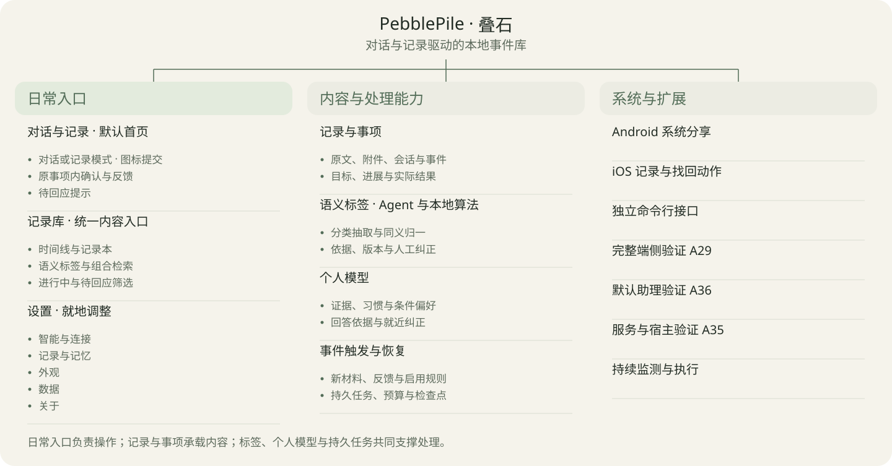

# 叠石 · 信息架构

| 文档信息 | 内容 |
| --- | --- |
| 版本与日期 | v1.1 · 2026-11-09 |
| 状态 | 信息架构设计稿 |
| 设计依据 | [产品需求文档 v1.3](prd.md) · [产品与技术调研 v1.3](research.md) |
| 用途 | 确定内容单位、功能层级、入口与协作能力，供原型设计和开发分工使用 |
| 配套图 | [入口与功能层级图](diagrams/information-architecture.svg) · [Mermaid 源文件](diagrams/information-architecture.mmd) |
| Paper | [功能与入口页](https://app.paper.design/file/01M41JA45T3KFWNYX3GFW8SB5Q/p-4-0) |

## 一、入口与内容单位

默认首页直接提供 **AI 对话与记录**。用户从明确的记录库入口回查内容，从设置管理记忆、整理规则与数据。原四项底栏调整为底部输入区，首页、记录库和设置承担不同频率的操作。

| 入口 | 用户要完成的事 | 主要内容与动作 |
| --- | --- | --- |
| 对话与记录：首页 | 留下材料，开始或继续处理一件事 | 直接输入、添加材料、对话／记录模式与图标提交；继续当前事项，回应必要确认 |
| 记录库 | 找回、编辑和整理已有内容 | 时间线、记录本、语义标签、人物与时间筛选；进行中、待回应等状态视图 |
| 设置 | 调整认识和处理方式，维护数据 | 智能与连接、记录与记忆、外观、数据、关于 |

首页顶栏保留记录库和设置的可见入口。记录库默认呈现时间线，记录本、标签和状态筛选作用于同一批内容。详情使用返回，搜索和更多操作随当前对象呈现。

| 内容单位 | 职责 | 关系 |
| --- | --- | --- |
| 记录本 Notebook | 浅层组织内容 | 记录可以暂不归本；新内容直接进入全部记录 |
| 记录 Record | 用户可编辑、可持续补充的内容单位 | 聚合原文、附件、会话和相关事件；正文与附件沿用来源版本 |
| 事项 | 需要持续跟进的记录 | 在记录上关联目标、决策、下一步、回执和结果 |
| 事件 Event | 从材料中整理出的经历或计划等结构化信息 | 保留主体、发生时间、观察类型和来源；一条记录可含多个事件 |
| 语义标签 Tag | 内容的分类与检索维度 | 通过标签指派关联记录或事件，并定位来源片段，保留依据和修订 |

**“Agent 标签”指 Agent 结合本地算法，为对话和记录生成的语义标签。** 它描述内容，服务于本地事件数据库的组织、检索和明确规则下的触发匹配。界面统一使用“标签”“自动整理”等名称；模型、算法与依据放在标签详情中。用户通过同一套个人状态获得帮助。

## 二、功能层级

### 2.1 首页：对话与记录

首页打开即可输入。顶栏下方提供“对话／记录”页面级分段选择，底部输入区采用图标提交。对话模式保存材料后展开处理，记录模式返回保存回执；切换保留草稿与当前记录。语音先转成可编辑文字；是否自动整理记录由设置中的规则决定。无模型时，文字保存、编辑和已有资料检索仍可用。

第一条实际内容建立记录；打开旧记录后，输入区继续该记录的上下文。补充材料、改变要求、选择方案与报告结果都回到原记录。需要持续跟进时，记录关联目标并成为事项。

普通整理进度附在对应记录上。只有需要用户补充、确认或反馈时，首页显示“待回应”提示，打开后定位到原事项。空库可以直接记录、填写明确偏好或打开独立示例库。

### 2.2 记录库：时间线、记录本与标签

时间线聚合记录、实际经历和事项进展。发生时间与记录时间分别保留；补记标明发生时间，尚未完成抽取的材料也能找回。对话消息、工具过程和整理步骤在详情中展开。

记录本用于主动归类，语义标签用于跨记录关联。用户可组合人物、时间、标签和状态筛选；搜索同时覆盖原文与有效结构化字段。标签导航复用同一记录详情，保留返回前的筛选范围。

记录详情包括正文、附件、关联事件、对话、标签及事项进展。来源位置、资源版本、建议、用户选择、执行回执和本人体验分别标明。用户可直接编辑正文、补记、纠正人物或时间、合并重复事件；修改返回影响范围与处理状态。

### 2.3 语义标签：自动组织与人工纠正

Agent 提出主题、场景、行为和情境候选，本地算法负责词表匹配、同义归一、去重、结构校验与索引更新。人物、发生时间、观察类型和事项状态保留结构化字段，标签查询可组合这些字段。

标签详情显示起源、来源位置、依据版本、算法版本和核对状态。置信度属于内部质量信号；通过校准后再决定是否向用户展示数值。低置信或竞争解释进入待核对，用户可确认、改名、合并、排除错误指派或撤销人工覆盖；人工修订优先于后续自动生成。

标签表达分类，事件事实由来源与观察类型确定，个人偏好由证据和明确表达确定。用户纠正或删除来源后，受影响标签随依赖失效，索引和触发匹配同步更新。

### 2.4 事项与事件驱动

事项在原记录中维护目标、期限、责任方、候选、下一步和结果。记录库的“进行中”“待回应”负责汇总；用户从对话或列表进入同一事项。

生活事件描述材料中的经历；处理触发描述系统何时继续工作。新增记录、补充材料、本人反馈和纠正可以触发相应整理；用户启用的规则还可按有效语义标签匹配事项。规则保存触发条件、作用范围、动作、预算和启停状态，执行仍受授权与版本检查约束。

持久任务保存处理进度、预算和恢复点。普通任务状态留在记录内，完整处理列表进入“设置 → 智能与连接 → 处理”。到期检查和持续跟进显示运行宿主、最近检查与等待条件，手机按可用运行窗口恢复。

### 2.5 设置

| 分组 | 内容 |
| --- | --- |
| 智能与连接 | 在同一卡片中呈现当前模型、连接与处理状态；复杂配置统一进入模型与连接页，队列按状态进入处理详情 |
| 记录与记忆 | 自动整理、推断辅助直接开关；记忆与偏好、标签规则按必要复杂度进入详情 |
| 外观 | 主题与文字大小直接选择；本轮浅色 VI 为当前可用方案 |
| 数据 | 当前资料库与人物、备份时间和恢复入口；需要范围预览与确认时进入详情 |
| 关于 | 应用版本、许可、说明与脱敏诊断入口 |

设置使用分组卡片列表，开关和切换就地操作，复杂配置再跳转。外观与关于分别呈现。记忆的完整管理放在设置。回答旁仍提供“依据”和纠正操作，用户也可直接表达“这是今天的例外”或“以后按这个来”；系统按当次条件与长期范围分别处理。

远程推理与外部 Agent 连接分别配置。前者决定材料在哪里处理，后者决定谁能读取或写回个人状态。标签详情与整理规则沿用相同的数据范围检查。

## 三、模块能力与入口矩阵

模块围绕同一份记录协作：输入留下材料，标签与事件整理建立可检索结构，个人模型提供相关认识，事项记录使用与反馈，实际结果再成为下一轮依据。

| 模块 | 独立能力 | 共同提供的能力 | 对应需求 |
| --- | --- | --- | --- |
| 对话与记录 | 输入、导入、编辑、系统分享、继续问答 | 为事件、标签与事项提供原始材料 | F02、F06、F10 |
| 记录库 | 时间线、记录本、标签筛选、来源与版本回查 | 关联原始内容、实际经历和后续结果 | F03、F08 |
| 标签与事件整理 | 分类、抽取、归一、去重、核对和索引 | 支撑找回、上下文筛选与范围明确的规则触发 | F04、F09、F13 |
| 事项跟进 | 目标、计划、选择、回执与本人体验 | 使用个人认识持续处理，并回收实际结果 | F06、F07、F09 |
| 个人模型 | 明确设置、习惯、条件偏好、证据与纠正 | 改善后续帮助，使变化可传播 | F05、F08 |
| 本地运行与数据管理 | 运行恢复、预算、备份与授权 | 保证资料、标签和个人状态可持有、可追溯 | F01、F09、F11、F12 |

| 功能 | 主入口 | 辅助入口与结果去向 | 对应需求 |
| --- | --- | --- | --- |
| 建库与模型准备 | 首次启动；设置 → 智能与连接 → 模型与连接 | 首页显示必要准备状态，已有资料继续可用 | F01 |
| 记录与导入 | 首页输入区 | Android 分享、iOS 系统动作；保存后关联同一记录 | F02、F10 |
| 事件、资源与组织 | 记录库 → 记录详情 | 记录本、时间线、标签和状态视图均打开原记录 | F03 |
| 标签、抽取与核对 | 记录详情 → 标签／整理结果 | 首页待回应；设置 → 记录与记忆 → 标签规则 | F04 |
| 明确设置与个人模型 | 设置 → 记忆与偏好 | 对话明确表达、回答旁依据与纠正 | F05 |
| 目标与个性化帮助 | 首页对话；原记录继续处理 | 记录库 → 进行中；候选与所用版本进入原事项 | F06 |
| 结果与本人反馈 | 原事项的对话或结果卡 | 时间线补记；回执与本人体验分别保存 | F07 |
| 纠正、停用与删除 | 相应记录、标签或认识详情 | 对话纠正、证据详情；显示影响范围与修订结果 | F08 |
| 整理、预算与恢复 | 记录内处理状态 | 设置 → 智能与连接 → 处理；规则入口为标签与整理规则 | F09 |
| 系统与开发入口 | Android 分享；iOS「记一件事」「找回经历」 | 短动作返回回执；CLI 供开发验证与批处理 | F10 |
| 备份、恢复与迁移 | 设置 → 备份与恢复 | 校验、预览后切换，返回当前资料库状态 | F11 |
| 权限、部署与诊断 | 设置 → 智能与连接 → 模型与连接；关于 | 错误提示连接具体修复项，撤权结果立即反馈 | F12 |
| 场景与通用性 | 设置 → 记录与记忆 → 标签与规则 → 场景与示例 | 标签词表与场景字段按版本解释；未知场景保留材料 | F13 |
| 采集与宿主适配 | 设置 → 智能与连接 → 模型与连接 → 扩展能力 | 经验证后开放默认助理与服务宿主入口 | F14 |

## 四、全局规则与组件承载

| 承载方式 | 适用内容 |
| --- | --- |
| 独立页面 | 记录库、记录／事项详情、设置及记忆详情、长证据阅读、备份预览 |
| 底部输入区 | 首页对话与仅记录；旧记录中的补充、追问与反馈 |
| 底部面板 | 材料类型、人物与标签筛选、标签详情、条目更多操作 |
| 弹窗 | 删除影响确认、修订冲突处理、简短且需要立即选择的提示 |
| 行内状态或提示条 | 保存回执、整理进度、等待原因、错误与下一步、待回应入口 |

「已保存」表示材料持久化；「正在整理」表示处理进行中；「等待条件」说明缺少条件；「需要核对」定位到具体内容；「已更新」表示有效派生状态已发布。事项是否完成依据实际结果单独显示，标签起源与处理状态分别表达。

系统入口取得回执后可返回原应用，后续整理进入持久任务。退后台、断网或进程回收后，App 显示已保存进度并恢复处理。搜索、标签筛选和跳转携带资料库及人物范围。

## 五、范围与验证

首期 F01—F13 覆盖首页、记录库、设置、系统动作和独立 CLI。完整端侧推理通过 A29 后声明支持范围；外部宿主与 Android 默认助理分别按 A35—A36 验证。持续监测由具备运行条件的宿主承担，自动同步、订票支付和复杂个人表示按后续需求评估。

| 验证 | 通过条件 |
| --- | --- |
| 入口闭环 A37 | 打开即可输入；仅记录可离线保存；记录库一次打开；从各视图进入同一记录并继续事项 |
| 标签质量 A38 | 归一、去重、来源定位和人工纠正可核对；低置信进入待核对；计划与生成内容保留观察类型 |
| 查询与触发 A39 | 标签检索可组合时间、人物与状态；只有已启用规则在授权范围匹配处理；重复触发只提交一次 |
| 修订与恢复 A40 | 纠正、删除、取消、中断及恢复后，标签、索引、触发和依据版本一致；人工排除得到保留 |

移动端页面、流程与交互规则见[原型说明](prototype-design.md)及[Paper 原型页](https://app.paper.design/file/01M41JA45T3KFWNYX3GFW8SB5Q/p-5-0)。原型覆盖主要闭环与等待、暂停、核对状态；后台算法和系统接口按 PRD 另验。
