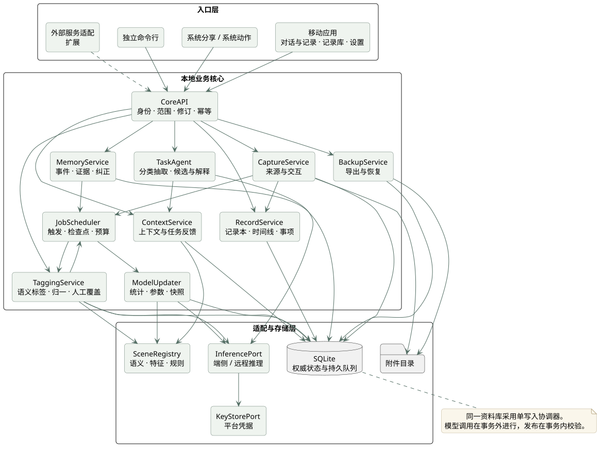
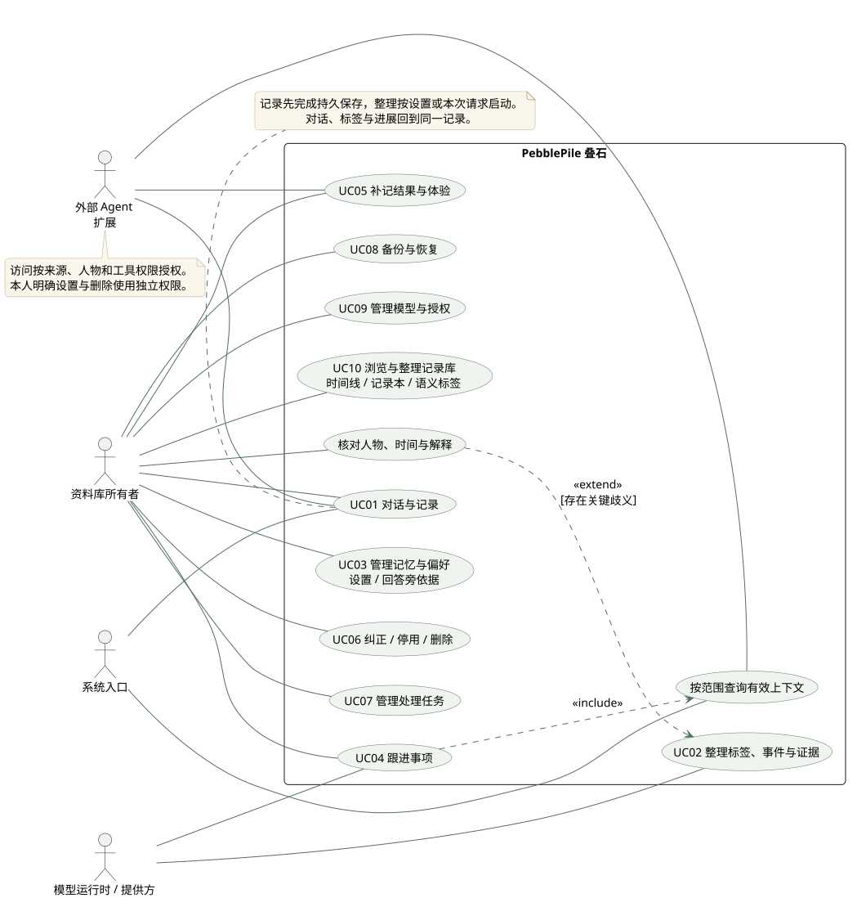
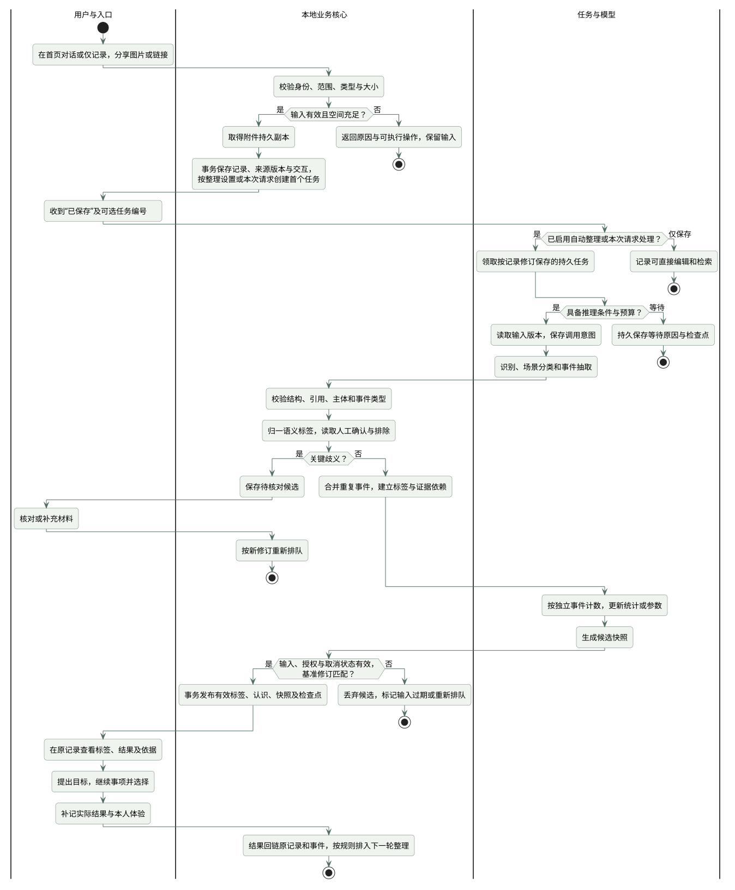
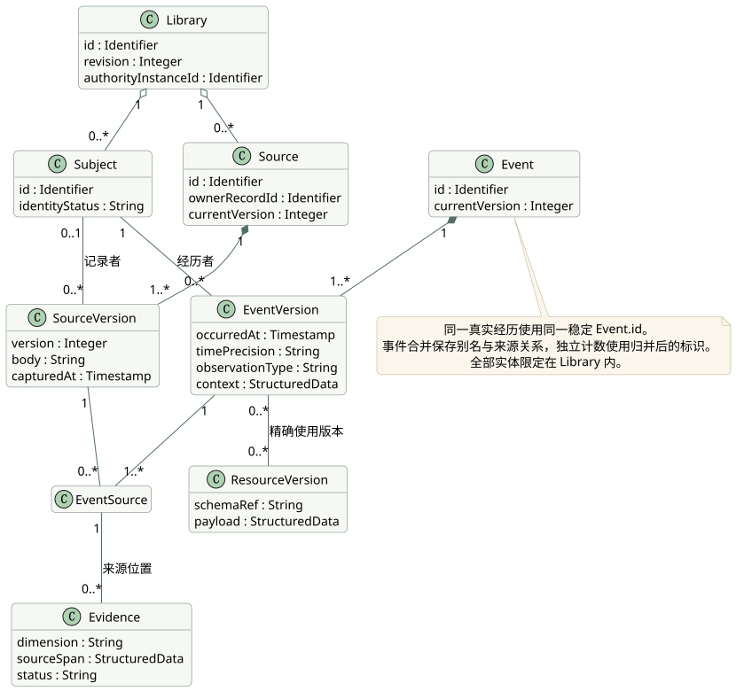
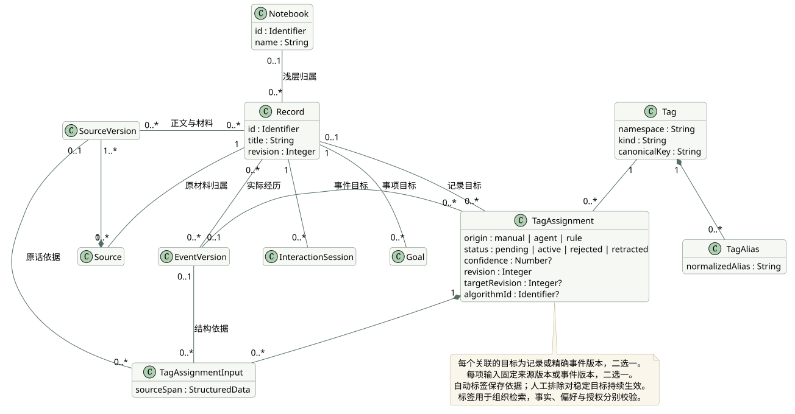
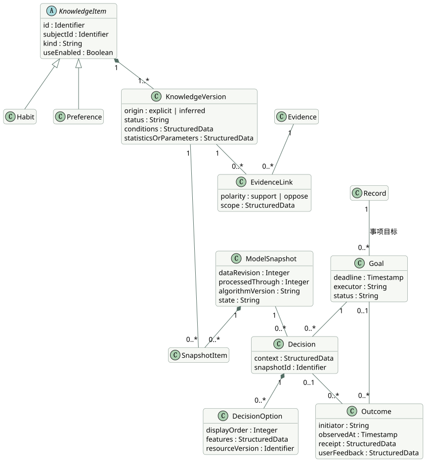
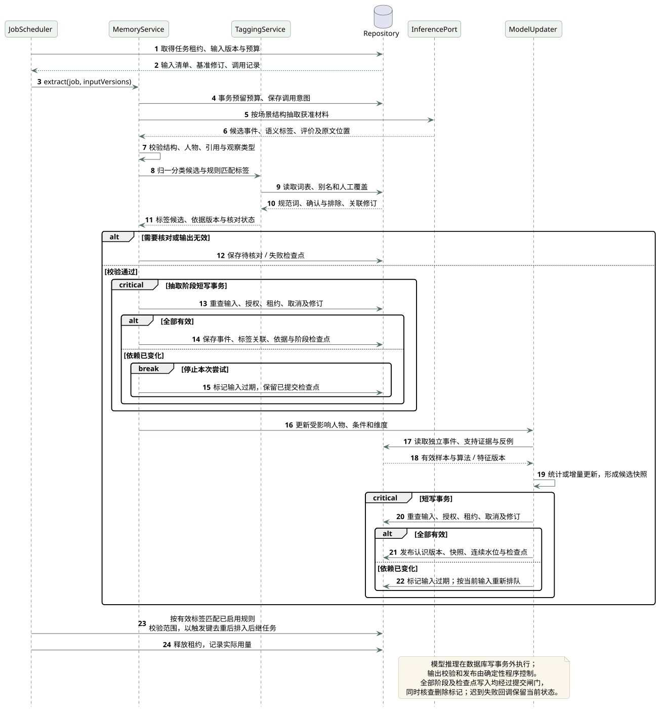
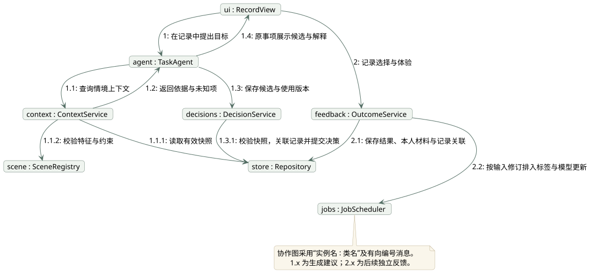
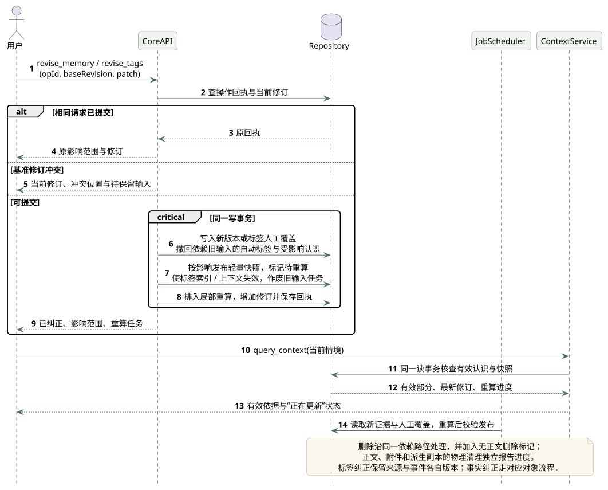
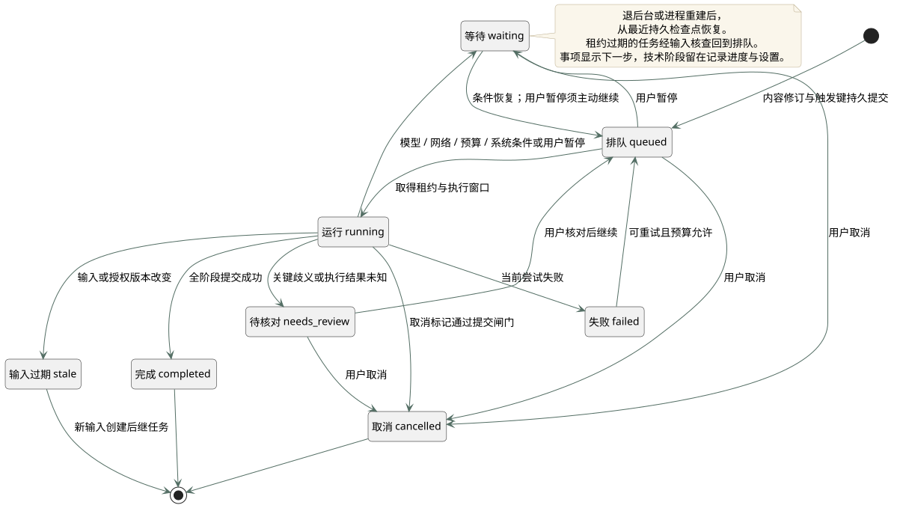

# 你所热爱的就是软件工程_系统设计说明书

| 文档信息 | 内容 |
| --- | --- |
| 项目 | PebblePile · 叠石 |
| 版本与日期 | v1.1 · 2026-11-09 |
| 文档状态 | 概要设计基线，供原型、开发和测试使用 |
| 需求依据 | [产品需求文档（Product Requirements Document，PRD）v1.3](prd.md) · [产品与技术调研 v1.3](research.md) |
| 配套文档 | [数据库设计说明书](database-design.md) · [课程作业要求](../task-requirement.md) |

## 1 引言

### 1.1 编写目的与范围

叠石是开源、移动端本地优先的个人记忆与偏好服务。首页直接承接 AI 对话与记录；Agent 结合本地算法整理语义标签、事件和证据，让本地记录可以按时间、主题和情境检索，再形成习惯与条件偏好，服务后续事项并随实际反馈更新。

本文说明软件边界、模块、运行流程、算法、接口与可靠性设计，覆盖 PRD 的 F01—F13。饮食用于深入验证，出行、消费、学习／工作、作息／运动共用事件与个人模型。F14 的外部宿主和识屏适配作为扩展；完整端侧推理按 A29 独立验收。本文的选型和算法属于待实现设计，验收结果随开发记录。

### 1.2 术语与缩写

| 术语 | 含义 |
| --- | --- |
| UML | Unified Modeling Language，统一建模语言；本文使用用例图、活动图、类图、时序图、协作图和状态图 |
| Agent | 智能体，围绕任务组织模型推理、工具调用和结果反馈的程序 |
| API / CLI | Application Programming Interface，应用编程接口；Command Line Interface，命令行接口 |
| MCP / HTTP | Model Context Protocol，模型上下文协议；Hypertext Transfer Protocol，超文本传输协议 |
| OCR | Optical Character Recognition，光学字符识别 |
| JSON / Schema | JavaScript Object Notation，结构化数据表示；Schema 指其字段、类型和约束定义 |
| URL / HTML | Uniform Resource Locator，统一资源定位符；HyperText Markup Language，超文本标记语言 |
| UTF-8 / token | Unicode 的八位编码形式；token 是模型分词器计量的文本单元 |
| ID / MiB | Identifier，标识符；Mebibyte，二进制容量单位，1 MiB = 1,048,576 字节 |
| 资料库 / 权威实例 | 个人数据与修订的边界；负责确认该库有效写入的实例 |
| 记录本 / 记录 / 事项 | 浅层内容集合；聚合正文、材料、会话和事件的可编辑记录页；带目标与进展的记录 |
| Agent 标签 | Agent 与本地算法生成的语义标签，用于组织、检索和匹配已启用的整理规则 |
| 标签 / 标签关联 | 规范化的语义词；该词与记录或事件的关联，含来源、依据版本、算法和核对状态 |
| 来源 / 事件 / 证据 | 原材料；一次经历或表达；带人物、观察类型和原文位置的判断依据 |
| 处理触发 | 保存、反馈、纠正或到期等状态变化，驱动持久任务；与生活事件数据分别建模 |
| 认识 / 快照 | 习惯或偏好；固定认识版本、参数、依赖与处理水位的一次发布 |
| F / N / A / M | 沿用 PRD 的功能需求、非功能要求、验收场景和实施里程碑编号 |

### 1.3 引用文件与编排依据

1. [本次课程作业要求](../task-requirement.md)：五类 UML、Agent 集成和数据库设计的交付范围。
2. [PRD](prd.md)：功能、数据规则、接口及 A01—A40 验收场景。
3. [research](research.md)：证据建模、增量更新、移动运行和跨工具复用的研究依据。
4. [GB/T 8567—2006《计算机软件文档编制规范》](https://openstd.samr.gov.cn/bzgk/gb/newGbInfo?hcno=84C42B6277D2714B7176B10C6E6B1A44)：参照 7.13 软件（结构）设计说明，按项目裁剪为设计决策、体系结构、模块与接口、执行方案、可追踪性。
5. [PlantUML 官方文档](https://plantuml.com/starting)：图形源码和本地渲染方式。

## 2 设计决策

| 决策 | 选择与原因 | 后续确认 |
| --- | --- | --- |
| 软件形态 | 自带移动应用调用本地业务核心，系统入口和 CLI 复用业务契约 | M0 固定客户端框架和核心语言，验证双平台嵌入 |
| 内容与导航 | 首页对话与记录；记录库提供时间线、记录本和语义标签筛选；记忆管理归设置 | 按 A37 验证同一记录的输入、回查与连续处理 |
| 权威状态 | 一台手机上的资料库确认修订；跨入口共用该状态 | 迁移到自管服务时显式切换权威实例 |
| 存储 | SQLite 事务库、私有附件目录、可重建全文索引 | 按 PRD N02 数据量测保存、查询和空间增长 |
| 推理 | 端侧与远程实现统一 `InferencePort`；个人状态留在本地核心 | 选定首期模型、设备和外发范围；完整端侧另验 A29 |
| 个人模型 | 条件规则、观察统计与在线逻辑回归候选方案 | 比较规则基线与增量模型的质量及成本 |
| 标签算法 | Agent 提出分类与抽取候选，本地词表、归一和版本规则校验；保留人工纠正 | 分别测标签质量、事件准确率和检索效果，见 A38—A40 |
| 一致性 | 原材料先保存；阶段检查点、输入版本校验和快照原子发布 | 故障注入验证中断、并发、迟到结果 |
| 可恢复性 | 持久队列接收系统可用执行窗口，任务按剩余预算继续 | 测试前后台切换、进程回收和断网 |
| 扩展 | 场景、模型、采集与宿主各有独立适配器 | 外部 MCP／HTTP 与默认助理按 A35—A36 验证 |

SQLite 是本文的存储设计基线。语言、界面框架和模型运行时沿用 PRD 的 M0 选型流程；模块契约先保持稳定，后续记录选型及测量结果。

## 3 体系结构与系统边界

### 3.1 分层结构

入口层负责交互和系统参数转换；业务核心负责范围校验、记忆更新与任务状态；适配层连接场景、模型和持久存储。界面展示核心返回的真实状态，所有写入口经过同一提交规则。

| 层次 | 模块 | 责任与主要产物 |
| --- | --- | --- |
| 入口 | 应用、系统分享、系统动作、CLI | 输入草稿、请求标识、保存回执、进度和纠正界面 |
| 应用服务 | `CoreAPI`、`CaptureService`、`RecordService`、`ContextService` | 授权检查、来源保存、记录与会话组织、时间线查询、上下文及事项结果 |
| 领域服务 | `TaggingService`、`MemoryService`、`ModelUpdater`、`OutcomeService` | 标签归一与依据、事件归并、证据依赖、习惯统计、偏好版本与实际体验 |
| 运行控制 | `JobScheduler`、`BudgetLedger`、`BackupService` | 任务租约、检查点、用量账本、备份与恢复 |
| 基础设施 | `Repository`、`AttachmentStore`、`KeyStorePort` | 事务、引用约束、附件持久副本、平台凭据 |
| 领域适配 | `SceneRegistry`、`InferencePort`、宿主适配器 | 版本化语义、推理输出、跨入口契约和能力报告 |

### 3.2 部署与数据边界

首期每个安装实例维护独立的本地库。应用和系统入口通过同一写入协调器访问该库；系统入口可以短暂唤起核心，完成保存后返回。CLI 在开发或测试宿主加载同一核心和指定数据目录。手机与桌面之间通过备份迁移资料库。

远程模型是可选推理依赖：请求包含已授权且符合预算的材料片段，响应进入候选工作区。连接密钥由平台凭据存储保管，数据库只保存引用。长期外部服务部署在用户自管宿主；移动端窗口、身份和地址可达性单独记录。运行依据见 [research 5.2—5.3](research.md#52-后台运行能支撑什么形态)。

### 3.3 领域 Agent 集成

自带 `TaskAgent` 负责理解请求、组织分类与抽取候选、调用上下文工具和解释依据；本地核心决定读取范围、标签归一和有效版本发布。Agent 输出经过场景约束与工具参数校验后执行。

Agent 标签表示对内容的语义标注。标签可表达场景、主题、行为和情境；人物、时间、观察类型等同时保留权威结构字段。标签用于组织和检索，事实成立、偏好推断和操作授权分别经过对应规则校验。

| 定制资产 | 内容与作用 | 版本记录 |
| --- | --- | --- |
| 场景包 | 对象、单位、事件类型、特征、约束与结果结构 | 命名空间、包版本、Schema 版本 |
| 抽取模板 | 中文样例、人物归属、实际／计划／转述判别及引用格式 | 提示模板版本、模型版本 |
| 标签词表 | 命名空间、类型、规范词、别名和标签组合规则 | 场景包版本、词表版本、归一算法版本 |
| 证据规则 | 独立事件计数、支持与反例、明确设置优先级 | 证据策略与算法版本 |
| 工具契约 | 记录、查询、反馈、纠正和任务控制 | 接口版本、能力清单 |
| 验证案例 | 饮食深测和四类场景边界、错误迁移与恢复案例 | 数据集版本与评分规则 |

饮食例子：用户记录“加班后洗锅太累”。Agent 提取当时精力、清理投入和评价；本地算法将候选标签归一为“饮食”“加班”“清理负担”，保留原话位置与版本。标签帮助用户找回相关记录，证据规则决定能否形成条件偏好。下一次加班选餐时，核心筛选适用认识，Agent 解释候选；真实选择和体验仍回到同一事项及证据链。份量换算由规则执行，资源修改经用户确认形成新版本。

## 4 用例与业务流程

### 4.1 用例图

所有者管理资料库和授权；系统入口转交用户请求；外部 Agent 按授权范围调用工具；模型提供方完成推理。用例图中的 `include` 表示必需子用例，`extend` 表示条件触发的补充流程。异步整理通过任务衔接记录用例。

### 4.2 主要用例说明

| 用例 | 前置条件与触发 | 主流程及完成结果 | 分支处理 |
| --- | --- | --- | --- |
| UC01 对话与记录 | 已有本地库；首页输入或系统分享 | 校验→取得持久副本→事务保存记录、来源、交互和按设置创建的整理任务→返回“已保存” | 仅记录先完成保存；模型缺失时材料仍可编辑检索；重复操作返回原回执 |
| UC02 整理标签、事件与证据 | 来源已保存且整理已启用，取得执行窗口 | 分类抽取→本地归一→版本及引用校验→事件归并→保存标签与证据→更新发布 | 缺模型等待；歧义待核对；过期结果终止提交；人工确认与排除优先 |
| UC03 管理记忆与偏好 | 打开设置中的记忆与偏好，或从回答旁查看依据 | 展示条件、起源、依据→用户启停、纠正或确认→发布新版本 | 明确设置即时生效；竞争解释保留冲突状态 |
| UC04 跟进事项 | 用户在记录中提出目标与条件 | 记录关联目标→查询上下文→筛选候选→保存决策→回到原事项展示依据 | 空库返回未知项；关键条件缺失先核对；动态资料过期时重新获取或标记 |
| UC05 补记结果与体验 | 选定目标、决策或独立经历 | 分别保存选择、动作回执、实际结果和本人评价→排入更新 | 结果未知进入待核对；离线反馈先保存 |
| UC06 纠正／停用／删除 | 所有者或具备对应权限的主体提交基准修订 | 校验修订→处理影响范围→停用旧认识→发布有效部分→局部重算 | 冲突保留输入；删除继续清理派生数据及附件 |
| UC07 管理处理任务 | 在记录内查看进度，或打开设置中的处理状态 | 查看阶段、预算和原因→暂停、继续或取消→返回持久状态 | 重复控制按操作标识去重；取消后迟到结果退出提交 |
| UC08 备份与恢复 | 用户选择导出或恢复包 | 导出一致版本；恢复在新库校验→预览→原子切换 | 损坏、空间不足或取消时继续使用原库 |
| UC09 管理模型与授权 | 所有者打开设置中的模型、数据或连接项 | 配置处理位置与范围→检查能力→保存配置 | 撤权使后续请求和在途提交重新校验 |
| UC10 浏览与整理记录库 | 打开首页的记录库入口 | 按时间线、记录本和语义标签查找→打开原记录→编辑、归类或继续事项 | 先校验访问范围，再做筛选与计数；待核对标签单独标示 |

### 4.3 记录、建模与反馈活动图

活动图按用户、本地核心、任务与模型划分泳道。“已保存”对应记录和来源的持久提交；标签整理、快照发布及事项执行分别报告状态。等待期间用户可以继续编辑和检索已有记录；整理完成更新原记录，时间线按内容与实际进展聚合。

## 5 静态结构与数据设计衔接

### 5.1 来源与证据类图

`SourceVersion` 保存某次采集的材料；`EventVersion` 表示对经历的某次解释，二者经 `EventSource` 建立多对多关系。记录者与经历者分别保存，事件发生时间保留精度，采集时间独立记录。领域资源是可选关联，事件固定实际使用版本。

### 5.2 记录组织与语义标签类图

`Notebook` 是浅层集合，`Record` 是用户编辑和继续处理的内容容器。记录可暂不归入记录本；一个记录可关联多个会话、来源版本、事件版本和目标，带目标与进展时以事项呈现。正文继续保存在 `SourceVersion`，记录页与时间线引用同一份内容。

每个 `Source` 保存所属记录 `owner_record_id`，其他记录可以引用其精确版本。移除引用保留原材料；删除所属记录时预览原材料及其他引用的受影响范围，按删除策略处理。

`Tag` 保存命名空间、类型、规范词与别名。`TagAssignment` 将规范词关联到记录或精确事件版本，保存起源、置信度、状态、修订及算法版本，多输入依据通过 `TagAssignmentInput` 固定来源或事件版本和原文位置。状态为 `pending/active/rejected/retracted`，分别表示待核对、有效、已排除和已撤回；用户确认与排除优先于后续自动整理。针对稳定对象的人工排除持续生效，直到用户撤销。

### 5.3 个人模型与事项类图

`Habit` 与 `Preference` 继承 `KnowledgeItem`，共同使用认识版本与证据关系。领域层保留类型差异，物理层映射到统一认识表；快照固定认识及算法版本，决策固定快照、候选顺序与资源版本。结果可直接关联经历，也可关联目标或决策。

图中实心菱形表示生命周期内的组成，空心菱形表示聚合，空心三角表示继承，连线数字表示关联数量。版本在正常更新中追加；删除按数据清理策略处理历史正文与派生副本。完整实体关系、字段、键和对象映射见[数据库设计说明书](database-design.md)。

### 5.4 全局一致性规则

1. 业务对象属于一个资料库；访问身份、人物范围和来源范围随请求校验。
2. 修改携带 `baseRevision`，写入携带 `operationId`；同标识同内容返回原回执，同标识不同内容返回冲突。
3. 同一真实经历按归并后的稳定 `Event.id` 计数，来源份数和证据片段数独立记录。
4. 快照固定输入修订、认识版本、场景与算法版本。`processedThrough` 表示已完成或显式终结的连续输入水位。
5. 纠正事务先使受影响认识失效，同时发布只含其余有效认识的轻量快照，标记 `pending_rebuild`；快照级参数置空，过渡期按有效明确设置与条件规则使用。查询和决策始终绑定有效快照。
6. 来源变化沿证据依赖传播到参数、快照、索引与缓存；删除标记参与在途任务的提交校验。
7. 标签候选固定记录修订与输入版本，提交时核查人工确认和排除。标签筛选先执行身份与来源范围过滤，再计算记录结果和数量。
8. 标签表示语义分类；事实观察类型、个人认识资格与授权分别校验。用户修改标签只改变标注，修改经历须通过事件或来源纠正流程。

## 6 模块与算法设计

### 6.1 摄取、语义标注和事件归并

`CaptureService` 校验文字、图片和链接：文字最多 10,000 字符，单张图片最多 5 MiB，链接响应最多 2 MiB。链接下载复查重定向和目的地址，附件先复制到私有目录并校验，再提交数据库引用与首个任务。崩溃后清理失去引用的暂存文件。

`RecordService` 管理记录本、记录与会话关联，并在已有记录内接受补充材料。仅记录模式保存正文和附件；后台抽取遵循资料库的自动整理设置。首页对话模式在保存后提交请求，对话输出保留生成内容起源与输入依赖。

`MemoryService` 将模型输出解析为候选事件、主体、情境、评价和来源位置，再检查字段类型、人物范围、原文片段、图片区域及输入版本。`TaggingService` 将分类候选和规则匹配结果归一为标签。未知场景保留原材料；关键歧义进入待核对。

| 阶段 | 确定性程序与 Agent 的分工 | 持久产物 |
| --- | --- | --- |
| 准备输入 | 按访问范围读取精确版本；规则提取已有结构字段 | 记录修订、来源版本及处理预算 |
| 分类与抽取 | Agent 提出场景、主题、行为、情境和事件候选，附引用；本地规则补充可直接计算的候选 | 带起源和原话位置的候选 |
| 归一与去重 | 根据命名空间、受控词表和别名合并同义词；保留未知词候选 | 规范 Tag 与候选关联 |
| 核对与提交 | 校验字段、依据、输入修订、置信度策略和人工覆盖；歧义保留待核对状态 | TagAssignment、依据版本和阶段检查点 |
| 检索与后继处理 | 发布有效标签索引，匹配已启用的版本化规则；在原记录更新状态 | 可查询关联、幂等后继 Job |

置信度用于核对和排序，阈值随算法配置版本保存。算法评估分别记录标签精确率与召回率、同义词归一错误、检索效果、人工纠正次数和处理成本。一次人工排除形成稳定对象与规范标签的覆盖规则，重新抽取时先读取该规则。

来源去重使用来源标识和内容摘要，事件去重结合主体、时间、行为及已有映射。确定为同一经历时保留别名和多来源关系；竞争解释交给用户核对。图片识别结果须回链原图区域，计划、转述、收藏和 Agent 输出各保留观察类型。

### 6.2 习惯、条件偏好与增量参数

`ModelUpdater` 的输入是有效事件、支持证据、反例、场景特征与现有版本，输出是候选认识和快照。

| 步骤 | 处理规则 |
| --- | --- |
| 资格过滤 | 按人物、观察类型、使用授权和当前有效性筛选；本人明确表达进入明确设置 |
| 独立计数 | 偏好至少两次独立实际经历；习惯至少三次观察，计数按事件归并标识 |
| 统计 | 保存观察窗口、观察次数、符合次数、时间分布和例外；频率分母为实际观察覆盖 |
| 条件建模 | 规则先表达情境与倾向；明确要求和当前约束优先，推断按启用状态参与低风险排序 |
| 参数更新 | 对可解释的实际选择或本人比较，使用候选特征差更新条件取舍参数 |
| 发布检查 | 校验依赖、范围、阈值、算法和数据版本；发布后保留证据入口 |

本版将在线逻辑回归作为增量参数候选，与规则计分对照。设 `x = φ(A) − φ(B)`，`φ` 为场景包定义并归一化的特征；`y` 为有依据的本人比较标签。偏好概率为 `p = sigmoid(w · x)`，一次更新可写为 `w ← w − η[(p − y)x + λw]`，其中 `η` 为学习率，`λ` 为正则系数。具体数值由开发集选择并写入算法配置。

共享、领域和情境参数分别保存。共享只作用于具有明确语义映射的维度；候选可得性、展示顺序、预算和行动发起者同时记录。Agent 的动作回执保存执行事实，本人的选择和体验提供偏好标签。参数概率经留出验证后决定展示方式。

纠正后的参数通过有效样本按固定顺序重放；先检查检查点是否依赖被撤回证据，受影响时退回更早的有效检查点。恢复同时固定特征、算法、随机种子和样本顺序。

### 6.3 更新时序图

模型调用在写事务外执行，结果先进入候选工作区。提交时重新核对输入版本、授权、任务租约、取消状态与修订；并发变化时重新读取有效输入。阶段幂等键由任务、输入摘要、阶段及算法版本组成，同一阶段只发布一次。

### 6.4 上下文、建议与反馈

`ContextService` 在一致读事务中选择有效快照，先匹配人物、事项和条件，再选取认识、必要反例与原文依据。语义标签缩小候选范围，最终使用仍核查原始依据、观察类型和适用条件。明确要求作为筛选条件；习惯提供背景；推断偏好参与排序。输出标明未知项、遗漏、预算和新材料处理进度。

返回状态为 `ready`、`empty` 或 `unavailable`，分别表示可用上下文、有效查询但结果为空、当前无法完成查询。空库建立空快照，明确设置可直接发布轻量快照。远程不可用时仍可查询本地资料，需推理的任务显示等待。

`TaskAgent` 使用上下文和场景规则生成少量候选，`Decision` 保存候选顺序、特征、约束、所用快照与资源版本。`OutcomeService` 分开记录用户选择、Agent 动作、宿主回执、实际结果和本人体验，再建立对应事件与更新任务。结果回到原记录或事项，用户可以从回答旁查看依据并纠正；完整记忆管理位于设置。宿主缺少使用回执时，将“已使用”状态保留为未知。

### 6.5 对象协作图

协作图也称通信图。节点采用“实例名 : 类名”，箭头表示消息方向，编号表示调用顺序与嵌套关系。`1.x` 完成任务帮助，`2.x` 是用户随后提交的实际反馈。图中存储访问由具备权限校验的仓储接口执行。

### 6.6 纠正、停用与删除

纠正先核对基准修订，再写入新版本；停用改变参与查询的状态；删除按依赖范围移除正文及派生数据。三类操作返回影响范围与当前修订。删除过程中继续维护无正文标记，以拒绝旧任务写回。

记录容器、标签关联与依据、附件、全文索引、模型快照、上下文缓存和含正文的交互结果纳入影响范围检查。仅移出记录本改变组织关系；删除记录按来源共享情况预览实际清理范围。保留历史决策时清除被删除内容，只留下允许保留的标识、状态和修订关系。用户另存的备份与外部副本在对应入口管理。物理清理按独立阶段返回进度，完整规则见数据库说明书。

标签纠正使用自身修订和人工覆盖规则：更换标签时排除原关联并添加新关联，来源与经历保持各自版本；修改来源或事件时，撤回依赖旧输入的自动标签并重新整理。已启动的标签规则任务在提交前重新核查关联状态和修订。

## 7 接口设计

### 7.1 通用请求与返回

请求包含接口版本、操作标识、必要的基准修订和业务参数。身份及资料库访问范围由认证上下文注入。进程内调用、CLI 和外部服务适配共享字段语义。

| 字段 | 规则 |
| --- | --- |
| `operationId` | 写入去重标识，结合客户端和资料库唯一；关联请求摘要及原回执 |
| `baseRevision` | 单对象修改使用目标稳定实体的 `revision`；跨对象批量修改使用库修订；冲突时返回当前值和待核对对象 |
| `authorityInstanceId / libraryId / revision` | 返回权威实例、资料库及本次读取或提交确认的修订 |
| `snapshotId / processedThrough` | 上下文使用的有效快照及连续处理水位 |
| `jobId / checkpoint / remainingBudget` | 异步任务及恢复所需信息 |
| `status / retryable / nextAction` | 业务状态、是否可重试及下一步操作 |

### 7.2 业务工具

| 工具 | 输入要点 | 返回要点 |
| --- | --- | --- |
| `record_experience` | 原材料、采集方式、时间、可选记录／记录本、人物、场景和仅记录模式 | 记录编号、保存回执、来源版本、已有或待整理事件、任务编号 |
| `query_records` | 时间范围、记录本、语义标签组合、事项状态和分页 | 范围过滤后的记录、时间线摘要、标签核对状态与游标 |
| `update_record` | 记录编号、基准修订、标题、归属和关联操作 | 新修订、内容关联与事项状态 |
| `revise_tags` | 目标、基准修订、确认／添加／排除／撤销覆盖操作 | 有效标签、人工覆盖、影响范围与更新任务 |
| `query_context` | 任务、人物、情境、字节与 token 预算 | 状态、条目、精确证据、快照、未知项、遗漏和进度 |
| `propose_preference` | 条件、倾向、证据及起源 | 证据检查、候选状态、冲突和版本 |
| `update_goal` | 记录编号、要求、期限、执行责任方、检查频率 | 事项关联、目标版本、当前状态及最近有效结果 |
| `record_outcome` | 目标／决策／事件引用、发起者、动作、回执和体验 | 结果编号、事件关联与更新任务 |
| `revise_memory / delete_memory` | 对象、基准修订、修改或删除范围 | 新修订、影响范围、清理／重算任务 |
| `get_task / control_task` | 任务编号、暂停／继续／取消动作 | 阶段、等待原因、预算和检查点 |
| `get_capabilities` | 客户端能力请求 | 接口、场景、处理位置、模型和宿主能力 |
| `export_data / restore_data` | 导出范围／备份包、校验和预览确认 | 包清单／恢复检查结果、切换状态 |

写入工具使用独立权限，明确设置与删除要求相应所有者授权。外部工具调用继承调用方范围，读取材料中的指令按材料内容保存。

### 7.3 错误与缓存

错误码分为 `INVALID_INPUT`、`FORBIDDEN`、`REVISION_CONFLICT`、`MODEL_UNAVAILABLE`、`BUDGET_EXHAUSTED`、`RESOURCE_EXHAUSTED`、`PROCESSING_FAILED`、`CANCELLED` 和 `STALE_INPUT`。错误响应带可重试性、已保存部分和下一步操作。

上下文缓存键包含权威实例、资料库、身份授权版本、人物与来源范围、查询、快照和预算。记录查询额外固定标签过滤条件、标签关联修订和排序游标。修订、撤权或快照失效触发缓存淘汰，返回前再次检查有效性。传输容量按 UTF-8 字节计量，推理预算按所选分词器计量。

## 8 执行、恢复与维护

### 8.1 任务状态与调度

`JobScheduler` 优先处理前台查询与纠正，再处理有限批次的整理。各阶段保存输入版本、输出摘要、租约、尝试次数和检查点；领取时递增租约令牌，提交同时核对令牌与期限，拒绝旧执行者写回。长调用保存意图、接收状态与远端操作标识。用户暂停保存为 `waiting(reason=user_paused)`，由用户继续后重新排队。进程重建后检查过期租约，核对输入和已提交阶段，再恢复任务。

一次文本整理或查询共享父任务预算：最多 3 次模型调用，每次输入最多 4,096 token、输出最多 1,024 token，最多 8 次业务工具调用、120 秒累计活动时间。分段与重试计入同一账本；图片 OCR、调度和用户等待单独统计。批量处理先展示总预算。

调用前原子预留额度，结束后按实际用量结算；远程超时保留已占额度与未知接收状态，核对后再决定重试。活动时间只累计实际执行区间。系统窗口结束时保存检查点，下次按剩余额度恢复。预算耗尽后保持等待；追加额度须记录新的预算授权，继续和重试保留累计用量。

处理触发复用持久队列。保存记录、收到反馈、纠正内容和到达检查时间是不同触发类型；生活 `Event` 继续表示经历本身。首期规则来自版本化场景包，资料库设置保存启用项、匹配范围和预算。一次触发与相应内容修订在同一事务中创建任务。

标签规则只匹配 `active` 关联，并核查用户明确启用的规则、适用范围和执行权限。`trigger_key` 由规则身份、目标记录和有效输入修订组成；任务输入固定记录及标签关联修订，父任务链共用预算。规则声明允许的来源类型和触发类型，默认处理用户保存、反馈与纠正；同一规则的生成输出不会再次触发自身。处理结果更新原记录或事项。

到期检查沿用目标的期限、最近与下次检查时间。调度器在系统允许的执行窗口或可达自管宿主上工作；移动端下次可运行时继续，并展示等待原因、最近检查时间和结果时效。事项进展留在内容页，后台阶段详情归设置中的处理状态。

### 8.2 故障处理

| 故障 | 恢复行为 |
| --- | --- |
| 保存时空间不足 | 事务回滚，保留草稿；回执说明实际保存范围 |
| 推理中断或模型缺失 | 来源继续可查，任务进入等待，恢复后重用检查点与剩余预算 |
| 重复提交、双击或消息重发 | 同操作标识返回原回执；阶段幂等约束阻止重复发布 |
| 纠正与旧任务同时提交 | 提交闸门校验输入修订，旧候选转为过期；有效部分继续查询 |
| 人工排除后再次自动打标 | 读取稳定对象的人工覆盖；旧标签保持排除，新候选按当前修订校验 |
| 标签规则重复触发或输入变化 | 触发键去重，规则提交核查关联修订；过期后继任务结束并按有效输入判断 |
| 撤销授权 | 后续读取和在途发布核查授权版本，缓存失效 |
| 动作超时且结果未知 | 查询宿主状态或请用户核对；有副作用的操作按宿主幂等能力恢复 |
| 索引损坏 | 从权威表重建，过渡期间回源过滤与检索 |
| 恢复包无效或迁移失败 | 在新目录停止恢复，原资料库继续使用 |

### 8.3 备份、部署与诊断

备份固定一致数据库版本、记录本与记录关系、标签词表和人工覆盖、附件清单、整理规则设置、格式版本、场景和算法版本及校验摘要。恢复先检查路径、大小、摘要、外键与版本兼容，再在新库试迁移和预览；确认后通过目录指针切换权威库。算法不匹配的自动派生数据重建，人工确认与排除保留，缺少场景包的载荷原样保留。

本地诊断保存运行时版本、阶段、用量、延迟和错误类别，常规日志记录标识及状态。开发交付包含核心构建、CLI 示例、模型准备、双平台安装和故障排查；自管服务扩展补充启动停止、认证、数据目录与备份路径。

## 9 需求追踪与验证计划

| 需求 | 设计落点 | 验收场景与证据 |
| --- | --- | --- |
| F01—F04 | 摄取服务、来源／事件版本、活动图与抽取时序 | A01—A08：离线、图片、链接、重复、人物与资源版本 |
| F05、F13 | 证据依赖、习惯统计、条件模型和场景包 | A09—A13、A31—A32、A34：条件、覆盖、跨场景与迁移 |
| F06—F07 | 上下文、目标、决策、协作图与结果服务 | A14—A16、A33：快照、反馈、单位换算、期限及结果 |
| F08 | 纠正时序、立即失效与依赖清理 | A17—A19：跨入口一致、删除、冲突和迟到写入 |
| F09 | 任务状态、预算账本、检查点与发布闸门 | A20—A22：中断、超时、取消、预算和空间不足 |
| F10、F12 | 核心契约、系统入口、CLI、认证和能力清单 | A23—A27、A30：核心复用、权限、安装与复现 |
| F11 | 一致备份、隔离恢复与原子切换 | A28、A31：往返、损坏、缺包及跨平台恢复 |
| 完整端侧能力 | `InferencePort` 的端侧实现 | A29：两台真机准备模型后断网完成全部推理环节 |
| F14 | 外部服务、默认助理与执行适配 | A35—A36：协议、宿主、观察生命周期及回执 |
| F02—F04、F06、F08—F09、F13 | 记录组织、语义标签、版本化规则与持久后继任务 | A37—A40：首页与回查、标签质量和归一、规则范围、纠正删除恢复与迟到写入 |
| N01—N04、N08 | 本地读写、短事务、调度、预算与诊断 | PRD 标准数据量下测响应分位数，并保存故障注入记录 |
| N05—N07、N09—N10 | 范围校验、输入校验、入口状态、备份和部署 | 权限、可访问性、迁移及干净环境复现记录 |

模型效果沿用 PRD 的三组对照、36 个冻结任务及三次运行规则，记录支持证据、条件错用、重复说明、纠正成本与总用量。文档检查验证结构和引用，运行验收由后续实现提供证据。

## 附录 图形源文件与交付

本文图形使用统一字体、颜色、方向箭头及领域命名。SVG（Scalable Vector Graphics，可缩放矢量图形）对应 [diagrams](diagrams/) 中同名 `.puml` 文件，修改后可用[渲染脚本](../scripts/render-diagrams.ps1)更新。图 4—图 6 拆开展示同一领域模型，以保留打印字号；数据库图独立展示键与关联。

课程提交文件名使用“你所热爱的就是软件工程_系统设计说明书.pdf”。本文保留 Markdown 和已渲染图形，转换时将 `docs/diagrams` 一并保留。项目图标见 [assets/icon.svg](../assets/icon.svg)。
