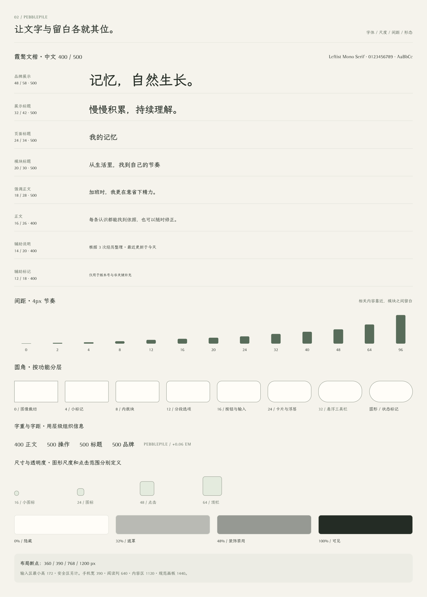
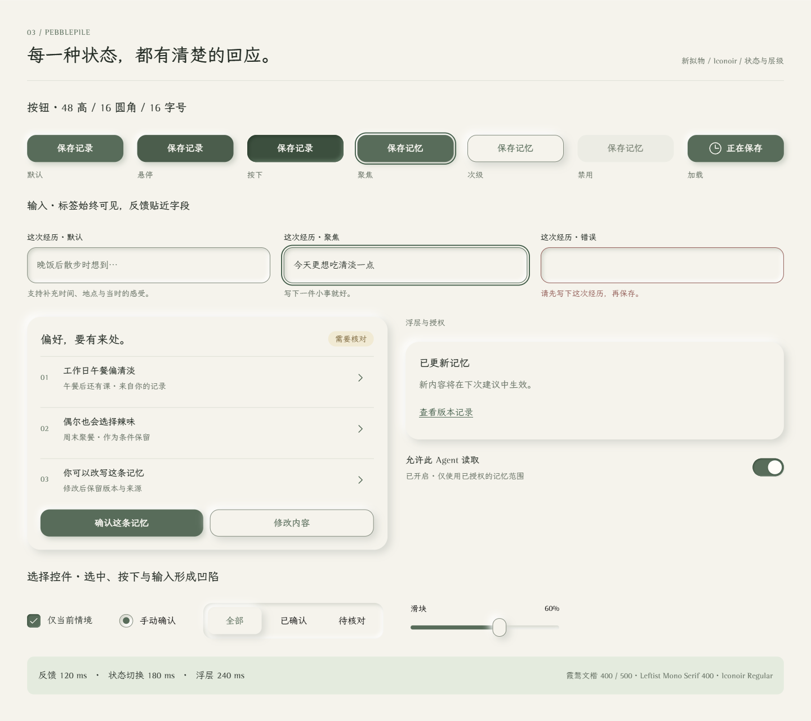
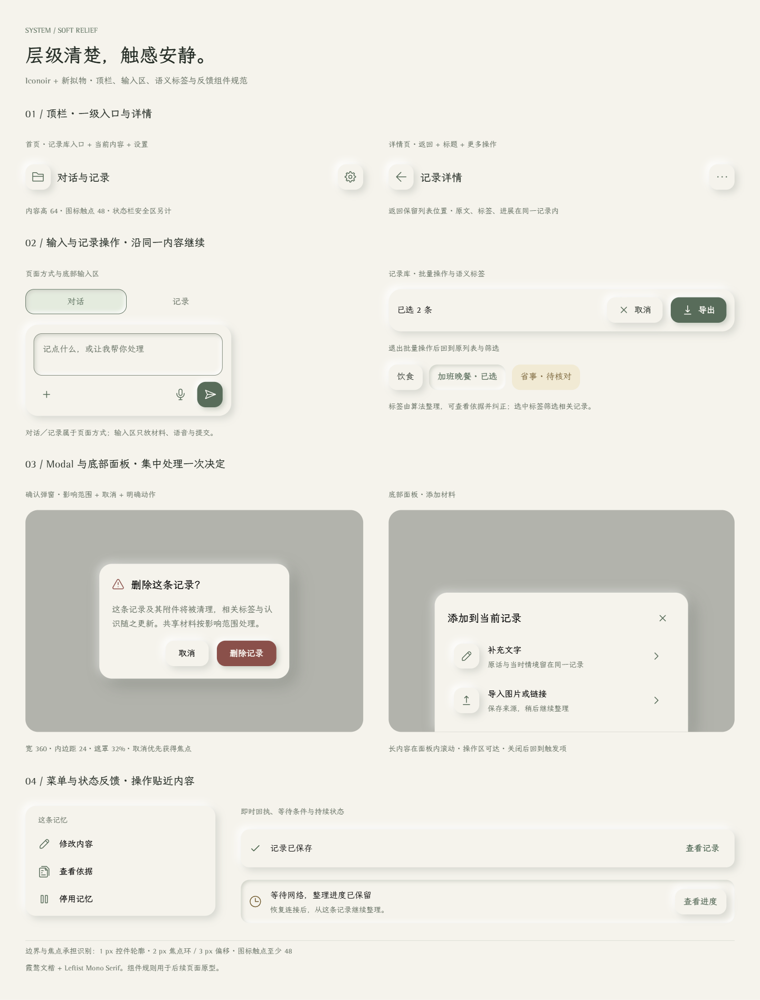

# 你所热爱的就是软件工程_视觉识别与设计系统说明书

| 文档信息 | 内容 |
| --- | --- |
| 项目 | PebblePile · 叠石 |
| 版本与日期 | v1.3 · 2026-11-09 |
| 已选方向 | 新拟物控件、Iconoir Regular、LXGW WenKai + Leftist Mono Serif |
| 字体状态 | 三个原文件已安装；六张正式画板已应用并视查，本地导览已核验真实字形 |
| 产品依据 | [产品需求](prd.md) · [产品与技术调研](research.md) · [信息架构](information-architecture.md) |
| 实现资产 | [设计 token](../assets/design-tokens.json) · [主题 CSS](../assets/theme.css) · [组件 CSS](../assets/components.css) · [Iconoir 集合](../assets/icons/SOURCES.md) |
| Paper | [VI 基线](https://app.paper.design/file/01M41JA45T3KFWNYX3GFW8SB5Q/p-1-0) · [探索与字体对照](https://app.paper.design/file/01M41JA45T3KFWNYX3GFW8SB5Q/p-3-0) |
| 字体规范 | [来源、字重与加载](../assets/fonts/README.md) · [文件记录](../assets/fonts/manifest.json) |

## 1 视觉方向

VI（Visual Identity，视觉识别）以天然河石为核心：生活材料逐渐积累，形成可查看、可纠正的认识。浅色河床承载内容，苔绿强调操作；同色表面的柔光与柔影表达凸起、凹陷和按下状态。

**正式控件采用新拟物，功能图标采用 Iconoir Regular。** 认识卡保留人物、情境、起源、证据和纠正入口；处理状态同时使用文字与图形。自然感来自轮廓、明暗与留白，界面文案直接说明记录、依据和结果。样张中的记录、人物与时间为虚构演示。

字体采用霞鹜文楷与 Leftist Mono Serif。中文正文用 400，标题与操作文字用 500；英文和数字固定为 400。字号、行高与字距沿用现有尺度。

本文用 token 表示具名设计值。CSS（Cascading Style Sheets，层叠样式表）提供变量与组件配方；JSON（JavaScript Object Notation，结构化数据格式）记录值、组合和验证状态。尺寸以逻辑像素表示。

## 2 标志与图标

### 2.1 品牌标志

三块青灰河石错位搭接，长短、重心与厚薄各异。约 30° 方位和 40° 俯侧视同时呈现顶面、侧面与接触关系，具体以图形为准。河流贯穿背景两侧，岸边点缀少量水草与芦苇。

| 资产 | 规则 |
| --- | --- |
| [app-icon.svg](../assets/app-icon.svg) | 带米白背景、河流与植物的应用图标；优先 48 × 48 以上，品牌展示优先 96 × 96 以上 |
| [icon.svg](../assets/icon.svg) | 透明背景的三石单色标志，24 × 24 视图；内联使用时通过 `currentColor` 设置颜色 |
| 名称组合 | 中文“叠石”、英文“PebblePile”；标志与名称相隔可见石堆宽度的 1/4，按视觉中心对齐 |
| 外部留白 | 以可见石堆宽度为 W，周围至少 W/4；文件自带空白计入留白 |
| 缩放 | 保持比例、自然轮廓与层间留白，按目标尺寸检查栅格效果 |

标志装饰色为 `stone-base #738278`、`stone-middle #576D60`、`stone-top #959F92`、`river #DEE8E2`、`river-line #A6BCB1`，均带 `--color-` 前缀。界面操作与状态使用下节的语义色。

### 2.2 功能图标

正式集合采用 **Iconoir Regular**，固定到官方提交 `39834e3f193bc0cca2c36bebb6a650471977433d`，保留 MIT 许可。34 枚 SVG（Scalable Vector Graphics，可缩放矢量图形）原生为 **24 × 24**、**1.5 描边**、`currentColor`，点击区域至少 **48 × 48**。[使用与来源](../assets/icons/SOURCES.md) · [语义映射](../assets/icons/manifest.json)

| 用途 | 语义 |
| --- | --- |
| 入口与视图 | `home` 首页、`library` 记录库／记录本、`timeline` 时间线、`tag` 语义标签 |
| 内容与设置 | `settings` 设置、`memory` 记忆与偏好、`tasks` 事项进展、`subject` 人物、`chat` 对话、`sources` 材料 |
| 编辑与管理 | `add`、`edit`、`delete`、`import`、`export`、`restore` |
| 处理与提示 | `pause` 暂停、`resume` 继续、`retry` 重试、`check` 确认、`warning` 核对、`info` 说明、`clock` 等待 |

材料与形成的认识分开；恢复备份、失败重试、继续暂停任务分别表达。选中态沿用同一图标轮廓，结合前景色、背景与文字字重。独立图标按钮提供动作名称；与文字重复的图标作为装饰处理。

[正式 Iconoir 图标板](https://app.paper.design/file/01M41JA45T3KFWNYX3GFW8SB5Q/p-1-0)保留 34 枚图标及容器状态展示。

## 3 色彩与灰阶

### 3.1 语义色

| 用途 | token | 色值 |
| --- | --- | --- |
| 页面底色 | `--color-bg` | `#F5F3EB` |
| 新拟物表面 | `--color-control-surface` | `var(--color-bg)` |
| 内容表面／次级表面 | `--color-surface`／`--color-surface-muted` | `#FFFDF7`／`#ECECE3` |
| 悬停表面 | `--color-surface-hover` | `#E6E8DE` |
| 主文字／次文字 | `--color-text`／`--color-text-secondary` | `#222C24`／`#5E6B5D` |
| 装饰边界／控件边界 | `--color-border`／`--color-border-control` | `#DADDD2`／`#788374` |
| 主操作／浅底 | `--color-primary`／`--color-primary-soft` | `#536D58`／`#E3EBDD` |
| 主操作悬停／按下 | `--color-primary-hover`／`--color-primary-pressed` | `#465E4B`／`#36503D` |
| 反色文字 | `--color-on-primary` | `#FFFDF7` |
| 焦点与链接 | `--color-focus`／`--color-link` | `#365B44` |
| 浅砂／深砂文字 | `--color-accent`／`--color-accent-strong` | `#E5DDC4`／`#6E5D40` |
| 右下柔影／左上柔光 | `--color-relief-shade`／`--color-relief-light` | `#D6D7CF`／`#FFFFFF` |

柔光与柔影表达材质。输入和选择控件的必要轮廓仍使用 `color-border-control`，焦点使用独立外环。

### 3.2 十一级灰阶

| `--color-neutral-*` | 色值 | 用途 |
| --- | --- | --- |
| 0 | `#FFFDF7` | 内容表面 |
| 50 | `#F5F3EB` | 页面底色 |
| 100 | `#ECECE3` | 次级表面 |
| 200 | `#DADDD2` | 装饰边界 |
| 300 | `#C2C8BB` | 装饰图形 |
| 400 | `#A0AA9B` | 装饰线条 |
| 500 | `#788374` | 控件轮廓、禁用文字 |
| 600 | `#5E6B5D` | 次级正文 |
| 700 | `#475344` | 次级强调 |
| 800 | `#323D32` | 深色图形 |
| 900 | `#222C24` | 标题与正文 |

日期、来源和帮助说明使用 `text-secondary`；禁用文字仅用于已禁用控件。

### 3.3 状态与起源

| 语义 | 文字色／浅底 | 文字与图标 |
| --- | --- | --- |
| 完成 | `#3E6246`／`#E5EFE2` | 已保存、已更新；`check` |
| 等待与核对 | `#775C29`／`#F3EAD2` | 等待条件用 `clock`；需要核对用 `warning` |
| 错误与危险操作 | `#934C47`／`#F5E6E2` | 保存失败、删除记录；异常或删除图标 |
| 整理与说明 | `#3C6470`／`#E6EEF0` | 正在整理、依据说明；进度或 `info` |

“本人明确”“根据经历推断”“外部工具结果”表示起源，与执行状态分别显示。认识的可信程度通过证据、条件和解释表达。

语义标签由 Agent 与本地算法整理，显示“自动整理”“人工确认”等起源；选中态表示当前筛选条件，待核对态表示分类仍需确认。标签详情提供依据与纠正。实际经历、计划和生成内容继续显示各自类型，标签用于组织与检索。

## 4 字体与排版

正式配对为 **LXGW WenKai（霞鹜文楷）+ Leftist Mono Serif**。中文与英文分别指定文本角色，按实际字体文件映射字重。[字体来源与加载规范](../assets/fonts/README.md)

| token | 值 | 用途 |
| --- | --- | --- |
| `--font-cjk` | LXGW WenKai | 中文主字体 |
| `--font-latin` | `"Leftist Mono Serif", "Leftist Mono Sans"` | 同一源文件的名称兼容链；英文、品牌英文与数字 |
| `--font-weight-regular` | 400 | 中文正文、说明 |
| `--font-weight-medium` | 500 | 中文标题、品牌、按钮、标签与导航 |
| `--font-weight-latin` | 400 | 所有英文与数字角色 |

主题通过 `local()` 按原文件的 PostScript 名绑定字体。Leftist 的 Serif / Sans 名称来自同一文件的两个名称字段，兼容链保留这层映射；Paper 试排回读到 `LeftistMonoSerif`，已核对真实衬线字形。`.pp-latin` 或 `data-script="latin"` 指定英文角色，并把字重固定为 400。中文标题与操作文字用文楷 Medium 500；筛选标签常态 400，选中 500。英文强调使用字号、间隔与颜色。主题设置 `font-synthesis: none`，保持原生字形。

Paper 的英文节点与混排片段直接设置同一字体名称链，解析到原文件的 PostScript 名。此处采用直接样式，以处理该工具对字体 token 兼容链的渲染差异；其余属性继续使用 token。具体回读值见[字体记录](../assets/fonts/manifest.json)。

`--font-fallback-cjk`、`--font-fallback-latin` 提供系统回退；字体验收以实际加载结果为准。Leftist 来源标注 Donationware，嵌入与再分发条款待确认，原文件保存在本地忽略目录。仓库交付规范、元数据与文楷许可。

| 样式 | 字号／行高 | 中文字重 | 英文字重 | 字距 |
| --- | --- | --- | --- | --- |
| xs | 12／18 | 400 | 400 | 0 |
| sm | 14／20 | 400 或 500 | 400 | 0 |
| base | 16／26 | 正文 400，操作 500 | 400 | 0 |
| lg | 18／28 | 500 | 400 | 0 |
| xl | 20／30 | 500 | 400 | 0 |
| 2xl | 24／34 | 500 | 400 | 0 |
| 3xl | 32／42 | 500 | 400 | −0.02em |
| 4xl | 48／58 | 500 | 400 | −0.02em |

字号、行高分别使用 `--text-*`、`--leading-*`。正文用 `--tracking-normal: 0em`；大标题可用 `--tracking-tight: -0.02em`；英文栏目标签可用 `--tracking-wide: 0.06em`。正文段间距 16，阅读区最大宽度 640；原话、错误原因和长链接自然换行。

## 5 布局、间隔与尺寸

间隔以 4 为基本节奏，2 用于细部调整。保留 `0、2、4、8、12、16、20、24、32、40、48、64、96` 十三级间隔：图标与文字间隔 8，卡片内部间隔 12，普通区块间隔 16，卡片与弹窗内边距 24。

手机基准宽度 390、页面边距 20；紧凑宽度 360 时边距可降至 16。宽屏断点 768，桌面断点 1200；阅读区、内容区、展示画板宽度分别为 640、1120、1440。CSS 媒体查询使用对应的构建常量。

| 组件 | 尺寸与圆角 | 对应 token |
| --- | --- | --- |
| 按钮 | 最小高 48，圆角 16，左右内边距 20 | `container-touch`、`radius-control` |
| 单行输入 | 最小高 64，内边距 16，圆角 16 | `container-input`、`radius-control` |
| 多行输入 | 最小高 80，内边距 16，圆角 16 | 组件组合值 |
| 卡片 | 内边距 24，圆角 24 | `spacing-24`、`radius-card` |
| 顶栏 | 内容高 64，透明容器；独立图标按钮圆角 16、触点 48 | `container-topbar`、`radius-control` |
| 对话与记录输入区 | 最小高 172，内边距 16，间隔 12，圆角 24；输入最小高 80，操作行 48 | `container-composer`、`radius-card` |
| 语义标签 | 最小触点 48，内边距 10／16，圆角 16；多行内容自然增高 | `container-touch`、`radius-control` |
| 悬浮工具栏 | 高 64，圆角 32 | `container-topbar`、`radius-toolbar` |
| 对话框 | 标准最大宽 360，宽版 480，内边距与圆角均为 24 | `container-dialog`、`container-dialog-wide`、`radius-card` |
| 底部面板 | 最大宽 480，内边距 24，上方圆角 24 | `container-dialog-wide`、`radius-card` |
| 功能图标 | 视图 24、描边 1.5、触点 48 | `container-icon`、`icon-stroke-width`、`container-touch` |
| 状态标记／列表行 | 视觉高 32／最小高 64；可操作区域至少 48 | 组件组合值 |

表中的 token 均加 `--`。顶栏和输入区的系统安全区另计，由外层容器承担；滚动内容按输入区实际高度留出空间。首页直接对话与记录，顶栏提供记录库和设置入口；记录库通过时间线、记录本、语义标签与状态筛选组织内容，记忆管理位于设置。详细入口关系见[信息架构](information-architecture.md)。

原圆角阶梯 `0、4、8、12、16、24、9999` 保留，正式组件使用新增的 `radius-control 16`、`radius-card 24`、`radius-toolbar 32`。字号与控件采用最小高度，内容增多时自然增高。

## 6 新拟物表面、阴影与层级

| 扩展 token | 值 | 用途 |
| --- | --- | --- |
| `--shadow-raised` | `6px 6px 14px #D6D7CF, -6px -6px 14px #FFFFFF` | 次要按钮、卡片、菜单、工具栏与提示 |
| `--shadow-inset` | `inset 3px 3px 7px #D1D4C9, inset -3px -3px 7px #FFFFFF` | 输入、选中与次要按下态 |
| `--shadow-primary` | `4px 4px 10px #C6CCC0, -4px -4px 10px #FFFFFF` | 主色按钮 |
| `--shadow-pressed` | `inset 3px 3px 6px #263F2D, inset -3px -3px 6px #58765F` | 主色按钮按下态 |
| `--shadow-overlay` | `12px 12px 32px #222C2433, -4px -4px 16px #FFFFFF80` | 对话框与底部面板 |

内容优先采用连续排版。普通操作采用默认凸起态；凹陷用于输入、页面方式与标签的当前项、按下反馈。通用分段选择保留凹陷轨道与凸起选项，选项状态在同一控件内保持一致。层级由位置、排版和组件状态表达，图标按钮提供可访问名称，省去功能解释型副标题和重复按钮文案。普通轮廓宽 1，必要强调宽 2；焦点环为 `2px solid var(--color-focus)`，外偏移 3。焦点和错误边界同时可见。

层级依次为内容 0、吸顶区域 10、菜单 20、对话框 30、提示 40。遮罩为 `#222C24` 的 **32%** 透明度。浮层内容保留自己的不透明表面。

## 7 正式组件配方

[components.css](../assets/components.css) 导入主题并提供 `.pp-*` 配方，使用于 `.pebblepile-theme` 容器内。图形、字号、间距和颜色读取同一套 token。

| 组件 | CSS 入口 | 规则 |
| --- | --- | --- |
| 主／次／危险按钮 | `.pp-button`、`.pp-button--secondary`、`.pp-button--danger` | 默认凸起，按下内凹；危险操作用危险色与反色字；禁用移除阴影，保留原因文字 |
| 图标按钮 | `.pp-icon-button`、`.pp-icon` | 48 触点内放置 24 图标；按钮提供动作名称 |
| 输入与错误 | `.pp-field`、`.pp-input`、`.pp-field__error` | 输入凹陷，错误通过边界和文字表达；帮助与错误内容关联字段 |
| 焦点 | `:focus-visible` | 2 外环、3 偏移；与按下、错误状态共存 |
| 认识卡 | `.pp-card` | 内边距 24、间隔 16、凸起表面；人物、起源、原话、依据和纠正操作分层 |
| 菜单 | `.pp-menu`、`.pp-menu-item` | 容器圆角 20、内边距 8、凸起阴影；每项触点至少 48，圆角 12，左右内边距与图文间隔均为 16 |
| 顶栏与工具栏 | `.pp-topbar`、`.pp-toolbar` | 记录库入口、当前内容与设置对齐，详情页保留返回与更多 |
| 对话输入区 | `.pp-composer`、`.pp-composer__actions` | 最多四行、超出内部滚动的输入；固定操作行；附件、语音与图标提交；切换保留草稿，提交按钮按模式提供发送或保存的可访问名称 |
| 页面方式 | `.pp-capture-mode`、`.pp-capture-mode__item` | 顶栏下方选择对话／记录，位于输入区之外；选中项内凹，切换保留草稿与上下文 |
| 语义标签 | `.pp-tag-list`、`.pp-tag` | 选中筛选项使用内凹阴影与 `aria-pressed`；待核对使用警告文字和浅底；起源与核对状态分别显示 |
| 对话框 | `.pp-modal`、`.pp-modal--wide` | 360／480 最大宽度、间隔 20；窄屏保留边距，长内容滚动 |
| 底部面板 | `.pp-sheet` | 最大宽 480，圆角与内边距 24，间隔 12，底部叠加安全区 |
| 短暂提示 | `.pp-toast-region`、`.pp-toast` | 居中对齐，上下／左右内边距 12／16，间隔 16，凸起阴影；由组件设置状态播报 |
| 行内提示 | `.pp-banner` | 凹陷表面，圆角、内边距与图文间隔均为 16 |
| 复选／单选 | `.pp-choice`、`.pp-choice__input` | 原生输入配可点击标签行，触点至少 48；复选勾号使用 Iconoir |
| 授权开关 | `.pp-switch`、`.pp-switch__input` | 开关同步“已开启／已关闭”状态文字 |
| 分段选择 | `.pp-segmented`、`.pp-segmented__item` | 外壳圆角 16、选项圆角 12，凹陷容器中以凸起项表达选择 |
| 滑块 | `.pp-slider` | 48 高操作区，显示当前值；进度由组件同步 `--pp-slider-progress` |

顶栏、输入区外层分别使用 `.pp-topbar-safe-area`、`.pp-composer-safe-area`。输入区随内容与键盘变化，运行时测量高度并同步 `--composer-occupied-height`，用于内容避让和提示定位。原生 `dialog` 通过 `showModal()` 打开，关闭态由 `[open]` 管理；自定义浮层由 `.pp-overlay` 承载。菜单键盘行为、模态焦点约束、关闭后的焦点归还、禁用动作与状态播报由组件程序实现。`data-state` 用于静态样张，真实状态以原生属性和语义属性更新。

卡片、菜单、对话框、面板和提示采用无描边表面；输入保留必要轮廓。加载时保留按钮宽度与状态文字。删除等操作说明对象与影响范围；提交结果、错误原因和重试入口放在稳定位置。多行内容增加容器高度，证据行的前导槽与尾部操作槽保持对齐。

## 8 动效与可访问性

动效使用 120、180、240 ms 三档，进入缓动为 `cubic-bezier(0.2,0,0,1)`，退出为 `cubic-bezier(0.4,0,1,1)`。控件状态平滑改变颜色与阴影；内容显隐使用透明度与少量位移。

主题响应 `prefers-reduced-motion`，将时长 token 设为 0。带 `data-decorative-motion` 的装饰子层停止动画、过渡和位移；定位变换留在外层，进度同时提供静态文字。[W3C 媒体特性](https://www.w3.org/TR/mediaqueries-5/#prefers-reduced-motion)

按 WCAG（Web Content Accessibility Guidelines，网页内容无障碍指南）2.2 检查声明配对：普通文字至少 4.5:1，必要非文本控件至少 3:1。[文字对比](https://www.w3.org/WAI/WCAG22/Understanding/contrast-minimum.html) · [非文本对比](https://www.w3.org/WAI/WCAG22/Understanding/non-text-contrast.html)

| 配对 | 对比值 |
| --- | --- |
| 主文字／页面背景 | 13.002:1 |
| 次文字／页面背景 | 5.058:1 |
| 反色文字／主按钮 | 5.586:1 |
| 苔绿文字／选中浅底 | 4.652:1 |
| 深砂文字／浅砂底 | 4.684:1 |
| 成功／警告／错误／信息文字与各自浅底 | 5.847／5.231／5.140／5.495:1 |
| 控件边界／页面背景 | 3.568:1 |
| 控件边界／悬停表面 | 3.202:1 |
| 焦点环／页面背景 | 6.907:1 |

完整 19 组配对保存在 JSON 的 `extensions.contrastPairs`，按原始计算值判断，表内数值保留三位小数。新拟物表面引用页面底色，沿用其文字、边界和焦点配对。状态结合文字与图形。[颜色使用](https://www.w3.org/WAI/WCAG22/Understanding/use-of-color.html)

项目统一采用 48 触点；WCAG 2.2 AA 的最小目标条款为 24 CSS px，并包含间距等例外。[最小目标尺寸](https://www.w3.org/WAI/WCAG22/Understanding/target-size-minimum.html)

| 实现验收 | 通过条件 |
| --- | --- |
| 文字放大与窄屏 | 200% 文字、360 宽度、长链接和多行错误信息下，内容及操作保持完整 |
| 键盘与焦点 | 焦点可见；菜单和对话框键盘可用；关闭后返回触发位置 |
| 读屏 | 控件有名称，错误关联字段，状态变化可理解 |
| 运行时状态 | 默认、按下、加载、禁用、错误、选中与减少动画设置符合配方 |
| 设备适配 | 触点、系统安全区、滚动遮挡与软键盘区域分别检查 |

## 9 Token 交付与验证记录

`paperTokens` 共 **122 项**。新拟物方案的颜色、尺寸与圆角沿用原值；字体族改为正式配对，中文保留 400/500，英文独立为 400。原 600/700 字重由实际可用字重替代。字号、行高与字距保持原值。`extensions` 保存字体角色、阴影、动效、层级、组件组合、对比配对与验证记录。

| 新增类型 | token |
| --- | --- |
| color | `color-control-surface`、`color-relief-shade`、`color-relief-light` |
| container | `container-input`、`container-topbar`、`container-composer`、`container-dialog`、`container-dialog-wide` |
| radius | `radius-control`、`radius-card`、`radius-toolbar` |

表内名称均加 `--`。Paper 保留颜色、断点、间隔、容器、字体族、字重、字号、行高、字距、圆角、透明度 11 类原生 token；扩展样式由精确 CSS 配方表达。

| 检查项 | 当前记录 |
| --- | --- |
| 已选方案 | 新拟物 A、Iconoir Regular、LXGW WenKai + Leftist Mono Serif |
| 字体整合 | 原文件名称与字重已核对，JSON、CSS 已映射；三个文件已安装，Paper 已识别，本地 Chrome 导览已核验实际字形来源 |
| Paper token | 122 项已回读，与 JSON／CSS 等价；当前 hash 为 `23078a09` |
| 本地资产 | JSON、主题变量与组件配方已同步；Iconoir 34 枚与固定官方提交一致 |
| 静态样张 | 字体整合保留已确认绑定；本次更新顶栏、输入区、语义标签、图标与信息架构，并回读样式、检查受影响区域 |
| 信息架构 | [Paper 架构页](https://app.paper.design/file/01M41JA45T3KFWNYX3GFW8SB5Q/p-4-0)区分日常入口与处理能力；对话与记录、记录库、设置与需求矩阵一致 |
| 对比计算 | 19 组声明配对沿用已核数值 |
| 历史记录 | 原 112 项基线与字体替换前的 123 项检查分别保存在 `previousBaseline`、`previousTypographyBaseline` |
| 运行时验证 | 键盘、读屏、动效、文字放大与设备触点按第 8 节验收 |

Paper 探索页保留字体、控件与图标的选择过程，正式规则以本文件和本地主题为准。移动端原型见[原型说明](prototype-design.md)，与[信息架构](information-architecture.md)共同维护。
